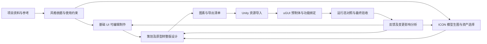

# SmartUI 通用游戏 UI 制作工具链总体规划

实现基线：SmartUI Krita v0.8.0。

本文只描述当前实现、能力边界和后续计划。当前处于阶段一：基础组件支持 Krita 制作与复查，ICON（图标）可由宿主生图后登记为独立资产，并与组件和文字组成静态预览。生成、登记、选用和组合的本地技术链路已验证；样片风格仍需用户确认。工具成功执行、模型视觉评估和用户确认分别记录，不能相互替代。

## 1. 最终目标与使用方式

SmartUI 是通用游戏 UI 制作工具。用户按项目提供参考风格、策划文档、原型和工程约定，AI 完成参考分析、基础组件制作、ICON（图标）生成、整版设计、资源输出、Unity 导入及 uGUI 预制体生成，并根据反馈持续修改。基础 UI 与 ICON 图像采用独立的制作流程，共享适用的风格依据，在 UI 预览中组合检查。

目标工作方式是 AI 执行制作与技术检查，人确认项目风格和最终效果。阶段之间的技术验收由工具和 Agent 执行，不额外增加逐步人工审批；必要输入缺失时，再提出具体问题。

首期在本机通过 Codex Plugin 使用现有模型和 Krita，优先把制作能力及交付正确性做实。以后再将稳定流程扩展为支持多项目、团队及不同模型分工的平台。专用模型或微调属于需要评估的能力路线，不作为当前本地工具开发的前置依赖。

全链路目标如下。图中包含尚未实现的阶段：

交付物应可复用、可追溯，并能在目标 Unity 项目中运行和继续迭代。基础 UI 保留可编辑程序和源文件；ICON 保留生成或编辑输入、实际图像及选用版本，生成的位图不等同于可分层编辑的 Krita 源文件。

## 2. 已明确的原则

| 原则 | 具体要求 |
| --- | --- |
| 工具通用，项目独立 | 工具仓库保存通用代码、Skill、接口文档、测试及可复用示例。具体项目的参考、规范、绘制程序、资产和运行记录留在各自项目中。 |
| 按资产性质制作 | 基础 UI 通过 Krita 原生笔刷、图层、蒙版及适用绘图接口制作，保存可编辑源文件；ICON 图像独立调用模型生图，不要求转换为组件绘制程序。页面布局和文字仍独立管理。 |
| 画法属于项目 | 模型根据参考和需求编写项目绘制程序，工具提供程序维护、预检与执行能力，不将某种按钮、材质或固定图层结构写成通用要求。 |
| 一致性可复用 | 同类组件共用适用的几何、用色和绘制规则；换色、状态和尺寸变体显式表达差异，不靠每次重新猜测。 |
| 结果可检查 | 风格规则保留参考依据；基础 UI 记录程序与执行版本，ICON 记录实际生成或编辑输入和选用图像；技术通过、模型视觉评估、用户确认分别记录。 |
| 修改范围明确 | 根据反馈确定共用风格、单个组件或页面范围，预先识别受影响内容，避免局部反馈扩散到无关资产。 |
| 文档由工具维护 | 项目结构化数据是事实来源，风格和组件文档是其可读输出，避免聊天结论、文档和实际产物各自形成不同版本。 |
| 错误清楚暴露 | 缺少资源、非法配置、外部改动和执行失败给出明确原因，不静默替换笔刷、吞掉异常或自动重发不确定的绘制请求。 |
| 先完成本地流程 | 暂不先建设账号、计费、云端调度等平台功能。平台化从已经验证的制作流程中提取需求。 |

首个 Unity 对接方向已明确为 uGUI，包括 Canvas、RectTransform 和项目自研封装。Unity 6 及以上版本优先使用已安装的 Unity CLI；具体能力须在实际工程中验证，CLI 无法覆盖的操作再采用明确的工程内适配方式。所有 Unity 修改直接在用户当前项目目录与当前分支进行。

## 3. 当前实现与证据边界

| 能力 | 当前状态 | 尚未覆盖的内容 |
| --- | --- | --- |
| 本地 Plugin 与 Krita 连接 | 已实现，提供 32 个 MCP 工具 | 尚无独立平台界面和团队协作 |
| 项目上下文及文档 | 已实现参考、风格、程序、组件、图像资产、静态组合和运行记录，以及自动生成的风格与组件文档；使用工程根目录入口、可配置制作目录及相对路径持久化，提供显式迁移 | 尚无策划、页面、导出资源、Unity 对象的完整关联模型 |
| 参考读取 | 已实现登记、预览、区域裁切、原像素取色 | 不包含自动语义识别、材质判断或可靠的字体反推 |
| 风格分析指导 | 已有 reference-style Skill，指导模型看图、归纳规则和记录依据 | 尚无系统化的跨风格复现质量验证 |
| 参考与产物对照 | 已实现指定参考区域与成功运行产物的裁切快照、等比缩放、并排图片及版本绑定；可通过 MCP 读取已保存的对照 | 不自动判断相似度、转换 ICC 色彩或推断两侧物理尺度 |
| 多产物视觉检查 | 已实现明确运行版本的多产物总览、原像素裁切、等比缩放、纯色背景、灰度图及已保存记录读取 | 尚无组件组、必需状态清单、页面布局或任意背景图；不自动判断视觉质量 |
| 偏差反馈与复查 | 已实现观察、修改建议、节点及规则关联，以及追加式复查记录；上下文和组件文档同步展示 | 模型或用户提供视觉判断；反馈解决不代表用户风格确认 |
| 项目绘制程序 | 已实现 Python 源码保存、版本、读取、独立进程执行及计划预检 | 尚无模型自动选择、模型评测或完整任务调度 |
| 实际绘制 | 已实现原生笔刷、路径与形状、分组、绘画图层和透明度蒙版，保存 KRA 与 PNG 预览 | 不支持全部 Krita 节点；不保留完整自由手绘的逐点压力、倾角和时间信息 |
| ICON 生成与页面组合 | Skill 指导调用宿主生图；已实现独立图像版本、选用、可更新布局及离线浏览器构建，支持正式资产九宫格和独立文本框；保存图像、字体及同页 PNG | 生图由宿主工具执行；尚无自动设计布局、父子分组、业务交互或运行态预览 |
| 局部修改 | 已实现同文件内指定节点更新及未选节点检查 | 画布尺寸或图层结构变化暂需新组件 ID，不是任意结构编辑或自动合并人工改动 |
| 版本影响识别 | 风格、规格或直接引用的程序变化可使组件需要复核 | 尚无程序间、组件间、页面到 Unity 的完整依赖分析及自动重建 |
| 技术验证 | 绘制流程包含保存重开后的节点 UUID、属性和像素一致性检查，以及局部修改范围检查 | 不等同于风格还原、可用性或最终运行效果通过 |
| 用户确认 | 当前保留确认字段，但没有确认记录工具 | 不能将工具成功或模型评价自动转成用户确认 |
| 生产交付 | 已实现明确组件运行的 PNG 区域导出、统一资产版本、几何声明、可复查清单和页面组合快照 | 尚无图层组单独导出、图集管理或 Unity 预制体交付 |

运行记录中的文件摘要用于追溯和相关操作校验，当前不是持续扫描所有资产的完整性监控。程序在本机独立进程执行，当前不是安全沙箱；共享平台若接受其他用户的程序，必须单独设计其执行边界。

## 4. 各层职责与数据关系

### 4.1 模型、Skill 和工具

| 层次 | 负责的判断或操作 |
| --- | --- |
| 模型 | 理解参考、策划和反馈，制定设计方案，编写项目程序，选择适用工具并评估视觉偏差 |
| Skill | 描述专业工作方法、证据要求、工具调用方式及交付标准；不把某个项目的画法变成全局模板 |
| 项目数据与程序 | 保存该项目的规则、资源、业务约定、可复用画法及制作记录 |
| 通用 MCP 工具 | 查询与更新状态，维护版本，校验和执行计划，返回真实结果及错误 |
| Krita 适配 | 将绘制计划落实为原生绘图操作和可编辑源文件 |
| ICON 工作流 | Skill 将内容、风格和使用约束交给宿主生图工具；MCP 登记结果、保留版本和来源并维护选用状态，不承担生图模型推理 |
| Unity 适配（规划） | 将资源、页面结构和项目组件约定落实为工程资产、uGUI 层级及绑定 |
| 任务与模型调度（规划） | 在已定义的输入、输出和验收规则之间分配任务与模型，管理等待、失败及续作 |

现有程序可以输出不同图层结构和批量笔触。未来扩展通用绘图能力时，应根据真实制作缺口扩展操作接口，不要求工具预先理解所有材质和组件类型。

### 4.2 需要贯通的项目对象

以下关系是目标数据模型；当前已实现参考、风格、绘制程序、组件、独立图像资产和执行记录，以及正式导出、可更新页面定义与浏览器构建快照。页面定义包含布局和资产绑定，尚不包含完整业务语义。

| 对象 | 应保留的内容与关联 |
| --- | --- |
| 项目描述 | 项目用途、目标平台、分辨率与语言要求、UI 框架及自研组件约定 |
| 参考与风格 | 参考来源、区域证据、观察与假设、适用范围、共用参数、版本及确认记录 |
| 基础组件 | 语义用途、交互状态、内容区域、尺寸规则、伸缩限制、程序和可编辑源文件 |
| ICON 资产 | 稳定标识、内容语义、风格依据、生成或编辑输入、实际文件与版本、选用状态及使用位置；不强制关联 Krita 程序或源图层 |
| 策划及原型 | 来源与版本、页面流程、数据字段、交互行为、状态和待确认事项 |
| 页面设计 | 语义节点、布局关系、组件实例、ICON 占位与资产引用、动态内容、交互区域及视觉预览 |
| 图素 | 稳定资源标识、来源组件节点或 ICON 资产及版本、导出区域、偏移、透明边界、适用的伸缩边界和文件 |
| Unity 交付 | 工程资产引用、导入设置、预制体节点映射、组件与行为绑定、生成和运行验证记录 |
| 反馈及执行记录 | 修改原因、目标范围、输入版本、实际操作、结果、影响对象及用户确认 |

项目风格文档与组件文档继续作为长期维护的两个基本入口。页面、资源和工程绑定说明按后续需求增加，不把所有信息塞进风格文档；这些内容都属于使用工具的项目，不进入工具仓库。

### 4.3 三种结构必须区分

Krita 图层表示绘制和编辑关系，页面语义结构表示内容和交互关系，Unity Hierarchy 表示运行时对象关系。三者应建立映射，但不要求一一对应。例如，一个按钮可以有多个绘画层，导出一个可伸缩背景图素，在 Unity 中由背景、动态文字和点击组件组成。

整版设计开始前就要定义最小布局与资源交付约定，使预览、切图和工程生成共享相同的组件身份与布局依据。动态文字、列表内容和交互热区应明确记录，不能只存在于整张位图中。

### 4.4 设计规范与视觉检查

设计规范应参与制作、变体生成和复查。当前 Skill、通用示例及工具支持颜色用途、状态变体制作和多产物视觉检查；真实参考的风格质量按第 8.2 节验收，示例运行成功不能代替参考复现验证。

| 改进方向 | 现有基础 | 后续工作及阶段 | 验收重点 |
| --- | --- | --- | --- |
| 按颜色用途复用配色 | 两项 Skill 指导按用途定义颜色；通用示例通过项目参数引用主题和颜色用途，并明确拒绝缺失引用 | 阶段一验证真实样片的颜色关系；后续按需要补工具级引用检查与影响查询 | 修改某一颜色用途后，引用它的组件使用一致的新配色；应共享的几何结构和不相关状态差异保持不变 |
| 成组管理组件状态与变体 | 已有共享几何的配色及状态示例，可将实际产物集中检查；尚无专门的组件组、必需状态清单或主题管理 | 阶段一验证真实状态及换色样片；阶段二再补组件组、项目要求的状态清单及管理约束 | 项目要求的状态没有遗漏；各状态容易区分，并保留应共享的轮廓、边厚、留白和内容位置；视觉状态与运行时业务行为分开验收 |
| 标准化视觉检查视图 | 已有创建与读取工具，可并排查看多状态、配色及修改前后产物，支持显示倍率、纯色背景和灰度图 | 后续根据真实试用补充必要视图；现有偏差记录仍通过单组件参考对照关联节点及规则 | 检查视图绑定实际产物、版本和处理参数，明确缩放、背景合成及颜色处理方式；已保存的视图保持原始内容，并标明是否仍对应当前项目记录 |
| 页面目标与信息优先级 | 已有固定坐标布局和浏览器预览，尚无页面语义模型 | 阶段三保存页面的主要操作、长期展示目标、辅助信息、当前业务状态及相关语义节点；据此复查整屏布局和强调方式，后续在运行态验证动效 | 当前操作和长期目标均可识别；说明、装饰与动效没有妨碍所需操作；评价能够对应到页面目标和具体节点 |

各层职责保持明确：Skill 指导模型分析颜色关系、状态差异和信息层级；项目参数与程序承载具体配色、画法及变体；通用工具维护版本、执行、检查材料和明确的配置约束。颜色用途、状态名称和参数结构由项目需要决定，不预设所有游戏共用同一套分类。

60/30/10、邻近色、补色及阶梯布局作为可选设计方法，不作为全局强制配方；不建立固定的视觉注意力排序或单一审美分数。后续通用校验只处理项目明确声明的必要引用、状态和尺寸约束，缺失或非法时直接报告；视觉层次、适用性和最终效果仍需查看实际画面，不能由参数合法或技术检查通过代替。

当前风格变更会使组件需要复核，但尚不能按某个颜色用途精确查询全部引用或自动只重建受影响资产。灰度、目标尺寸和背景预览属于检查手段；页面组合由独立布局与构建工具处理，不代表运行时渲染或用户注意力预测。

### 4.5 基础 UI 与 ICON 的独立制作和组合检查

基础 UI 负责面板、按钮、边框、状态以及 ICON 容器的位置、尺寸、留白、对齐和交互区域。ICON 图像负责道具、货币、技能等内容的美术表达，采用模型生图或图像编辑。图像内容与点击行为分别管理，不能因图像由模型生成而丢失 UI 语义。

两条流程共享项目参考和适用的风格规则。ICON 输入应包括内容语义、造型与描边、配色与明暗、细节密度，以及实际显示尺寸、使用背景、透明背景需求和安全留白。面板的圆角、九宫格和拉伸规则不直接套用到 ICON。生图工具和具体模型依据宿主能力及验证效果选择，不绑定某个服务商，也不预先建设多模型调度平台。

先确定容器与目标尺寸，再生成少量代表性 ICON；查看实际结果后，将选用图像按目标尺寸放入 UI 组合，检查辨识度、视觉重心、留白、文字关系和风格一致性。单图质量与组合效果分别评价，不能以单张大图好看来代替实际显示效果。预览组合保留组件、文字和 ICON 的独立来源与布局依据，不用整张 UI 生图替代组件制作和页面结构。

同一 ICON 在多个位置复用同一选用版本。单纯改变布局或容器位置不触发生图；显示尺寸或背景改变时先复查实际效果，需要改图时才针对选定资产生成或编辑。替换一个 ICON 只更新相关引用和组合预览，不重画无关组件。生成记录按工具实际返回的信息保存，不伪造模型版本、随机种子或完全可复现的承诺。

占位是明确的设计状态，可以用于布局检查；占位预览不能作为完整美术效果验收。已明确引用的实际资产缺失时应报错，不能静默退回占位。生成候选、选用图像、技术检查和用户确认分别记录，生成成功不等于选用或确认。

当前组件接口要求 `spec.program_id`，并排视觉检查只接收组件成功运行；ICON 通过独立图像工具登记和选用，不能伪装成 Krita 绘制记录。页面布局以 `asset_id` 与明确的 `binding` 引用资产，正式资产按 `geometry` 伸缩，文字保持为独立文本框。`project_create_composition` 另提供引用 `component_id/run_id` 或 `asset_id/version` 的简单快照，仅支持等比图像和单行文字。两种流程都校验真实字体及字符，保留各次实际快照；选用新图不会改写历史结果。接口参数见[项目工具说明](project-tools.md)。

### 4.6 页面布局与浏览器预览

页面制作采用 AI 修改结构化布局、用户在浏览器查看效果的方式，首版不建设拖拽编辑器。基础组件继续由 Krita 制作，页面引用真实导出图像；布局的事实来源是项目中的结构化定义，HTML 和 PNG 都是派生产物，不从网页样式反推或同步另一份页面定义。

浏览器预览已实现。本地 HTML/CSS 表达实例位置、叠放顺序和文字区域，Canvas 按共用几何裁片绘制九宫格，防止跨片插值。PNG 使用同一 Chromium 页面，等待图像和指定字体成功加载，固定参考尺寸和像素比 1，记录实际渲染环境。字体文件及所需字符严格校验，文字由浏览器排版，不另用 Pillow 或 Canvas 排字。

可更新布局维护稳定的页面及实例身份、修订、资产绑定和独立文本框。构建解析成确切资源版本与摘要，保存离线 HTML、PNG、输入定义和资源文件；历史读取不依赖原始资源仍存在。固定版本保持不变，跟随选用在显式重建时更新；布局修订匹配和资产绑定匹配分别报告。简单静态组合继续按其自身接口创建和读取。

未来 Unity 适配读取布局及资源约定，不把 DOM 或 Krita 图层树直接当作运行时层级。浏览器预览用于页面设计检查，字体、缩放和交互的运行效果仍在目标工程中验证。点击热点、页面跳转、复杂响应式布局及可视化编辑在有明确需求时另行安排。

## 5. 分阶段推进与验收

阶段顺序以依赖关系为依据，不是工期承诺。当前继续阶段一的质量验证，并按第 8.4 节提前完善资产复用与页面组合；其他后续阶段先有总体边界，临近实施时再补充必要的接口和数据设计。

| 阶段 | 核心交付 | 进入下一阶段的依据 | 当前状态 |
| --- | --- | --- | --- |
| 阶段零：工具执行基础 | 本地 Plugin、项目存储、原生绘制、项目程序、保存及修改验证 | 实际文件可编辑、操作可追溯、错误可定位 | 已实现；各次实际执行结果由运行记录及对应检查确认 |
| 阶段一：参考风格到确认样片 | 有依据的风格规则、项目程序、组件样片及反馈，以及小型 UI 组合中的 ICON 生图验证 | 基础组件及 ICON 的风格和组合效果有检查依据并获得用户风格确认；至少一个组件变体遵守共用规则 | 制作、对照、图像登记与静态组合已实现；ICON 本地技术链路已验证，样片风格确认和确认记录工具仍待完成 |
| 阶段二：基础组件库 | 代表页面所需组件、状态与变体、尺寸和伸缩规则、编辑及复用记录 | 组件可以复用和局部修改，所需状态和内容区域明确 | 已具备资产身份、内容区域与伸缩能力；组件组及状态清单待实施 |
| 阶段三：策划与原型到整版设计 | 页面语义及布局描述、组件实例、必要设计层级和整版预览 | 代表页面覆盖策划流程，动态内容与交互结构明确，可交给导出和 Unity 阶段 | 已实现可更新固定坐标布局与浏览器快照；页面语义、分组及业务结构待实施 |
| 阶段四：切图与图素管理 | 可重复的导出任务、图素清单、元数据和变更记录 | 资源身份稳定，导出正确，共享资源更新不产生错切、重复或失联 | 已实现明确运行的区域导出与清单，尚未覆盖图层组导出及工程适配 |
| 阶段五：Unity 交付 | Sprite 资源、导入设置、uGUI 预制体、自研组件适配及约定的功能绑定 | 在真实工程中通过画面、层级、引用和运行态检查 | 未实施 |
| 阶段六：全链路增量维护 | 变更影响分析、按需重建、跨阶段追溯和回归检查 | 局部反馈可传播到工程，无关内容及有效引用保持稳定；用户确认实际最终效果 | 未实施 |
| 阶段七：平台与模型分工 | 项目工作台、任务编排、模型能力接口和后续团队使用能力 | 多项目隔离，任务可续作，模型选择有质量、成本与速度依据 | 未实施 |

### 阶段一：验证模型的风格理解与自主绘制

利用现有工具从真实参考开始，让模型记录规则、编写项目程序、制作样片、查看实际产物并依据偏差修改。先完成样片质量验证，再依据缺口补工具；不把再次运行已有示例当作模型重新理解参考的证明。

这一阶段需要形成：

- 可追溯的规则：例如用色关系、轮廓、边厚、亮暗分区、适用材质和伸缩行为，明确证据与假设。
- 同尺度的参考与产物对照，以及可操作的偏差记录；颜色和几何统计可以辅助判断，但不能代替视觉评估。
- 样片、至少一个共用规则的变体、一次原文件局部修改，以及对应程序和实际版本。
- 用户风格确认的记录方式，将确认绑定到具体风格版本和样片；当前尚缺此工具能力。
- 一份流程测量：模型调用次数、总耗时、程序执行与绘制耗时、人工介入和修改轮次，避免仅用单批笔触耗时评价整体效率。

在宣称具有通用复现能力前，建议至少使用另一组视觉特征明显不同的参考重复验证。测试输入留在各自项目；工具测试只保留独立可用的合成资料和通用行为验证。某个材质不适合当前接口时，明确其缺口，再决定补充笔触接口、改进模型工作方法或评估专门模型。

现有工具支持以下制作与复查流程：

- `project_compare_component` 保存指定参考区域与成功运行产物的原像素裁切快照和显示倍率；`project_get_comparison` 校验并返回对照及关联反馈。模型负责选择适用区域和比较尺度。
- `project_record_feedback` 保存观察、修改建议及关联节点和风格规则；`project_update_feedback` 追加复查记录。解决偏差须关联同组件、同参考区域且晚于原始运行的成功产物对照。
- `project_create_visual_check` 集中展示 1 至 16 份指定成功运行的产物，支持裁切、等比缩放、纯色背景及背景合成后的灰度图。`project_get_visual_check` 校验并返回已保存的检查图及来源记录。
- 对照与检查绑定实际版本及处理参数，保存的快照保持原始内容。上下文和组件文档区分记录是否仍对应当前运行、规格、风格和程序；重新绘制不会自动关闭反馈，已有复查结论不自动适用于新产物。
- reference-style 与 krita-drawing Skill 指导模型查看实际产物、记录偏差、调整程序或参数并复查；`semantic_palette.py` 通用示例演示两套主题和三个状态共用几何。颜色和状态名称由项目定义。

这些能力提供制作和检查手段，不构成真实参考的质量验收。阶段一仍需完成真实样片及变体的视觉验收、用户风格确认记录能力和完整流程效率测量。

### 阶段二：形成能复用的基础组件库

先选定一张贯穿后续阶段的代表页面，再从其实际需求选择组件，不预设所有游戏都需要相同组件目录。区分可复用组件、装饰元素、ICON 资产和内容槽位；按用途记录正常、禁用、选中等实际需要的状态。ICON 图像通过独立生图流程制作和复用，容器及布局约束由基础 UI 管理，不为每张 ICON 强制编写 Krita 程序。

同类组件明确哪些参数共享，哪些允许实例覆盖。尺寸变化需要说明固定角部、边厚、内容留白、可拉伸区域和最小尺寸；采用九宫格的组件需验证边角与中心区域的行为。标签文字、字体资源和动态内容区域要独立于背景图素管理。

按实际编辑任务补充结构修改能力，例如增加或移除图层、调整分组或画布尺寸，并保持仍然有效的节点身份及后续引用。当前限制须显式保留在文档中，不能把所有结构变化都包装为普通局部更新。若现有接口已经满足当前组件制作需求，不为假想需求先扩展全部 Krita 功能。

### 阶段三：从需求形成可交付的整版设计

接收策划文档和原型，提取页面、流程、数据字段、状态和操作，并保存来源与版本。设计节点应能追溯到相应需求，使后续导出与工程生成也能读取页面用途及交互要求。

在复用组件的基础上生成布局与设计层级，记录定位、尺寸、锚点或布局约束、层级关系及动态内容。制作必要的独立装饰和新组件，并把可复用部分补回组件库。ICON 槽位引用明确的资产版本，组合预览使用实际图像；尚处于占位状态的区域应明确标示，不计为完整美术效果通过。

沿用阶段二选定的代表页面，用同一份页面描述贯穿设计、切图和 Unity 交付。预览应从该结构及资产生成，使后续工程生成有可执行的布局依据。Krita 编辑层与页面运行节点分开组织，文字、列表或按钮行为不因预览栅格化而丢失。

固定坐标页面已明确像素单位、参考画布、资产身份、伸缩、文字及绑定约定，使用第 4.6 节的浏览器预览。阶段后续补充动态内容、业务语义、设计层级和必要的布局约束，不把当前组合能力视为策划流程已完整实现。

### 阶段四：导出和维护图素

为组件或页面节点定义导出范围，输出正式资源及清单。PNG 预览不能直接被当作已经完成的生产切图。

清单至少能表达资源身份、来源和版本、透明边界、裁切偏移、尺寸及适用的轴心和九宫格边界；基础 UI 关联来源节点，ICON 关联选用的图像资产及生成或编辑记录，不要求其具有 Krita 图层。字体和其他图像按实际类型保留所需信息。导出后检查尺寸、透明度、边缘、适用的伸缩结果及页面重组效果。

更新同一图素时保持其身份和预期路径；共享图素的引用关系可查询。图集策略、压缩和分辨率策略由目标工程需求决定，不写成所有项目的固定参数。无引用资源清理必须单独识别，不能在普通导出中顺带删除。

### 阶段五：Unity 导入、预制体和功能绑定

先读取目标工程的 Unity 版本、uGUI 组织方式、资源目录、字体与图集约定、自研组件、加载方式及绑定约定。将这些差异写成项目适配描述；通用工具不硬编码某个工程的脚本类名和目录。

通过适用的 Unity CLI 或工程内编辑器接口完成资源导入和预制体生成。根据页面语义和布局建立 Canvas/RectTransform、图像、文字、交互与布局组件；按项目约定决定分组、复用子预制体及绑定方式，不把绘画图层机械复制成 Hierarchy。

需要对接的功能包括约定的数据字段、点击行为、状态变化和现有脚本引用。UI 接线不等于自动实现未知业务系统；缺少目标 API 或行为定义时，要明确列出缺口。代表页面的已明确交互必须在真实工程中验证，不能仅凭序列化字段存在判定成功。

验收覆盖工程编译、资源引用、层级结构、实际分辨率和必要的动态内容、交互与布局。将 Unity 实际渲染和设计预览对照，检查字体、缩放、描边、九宫格和位置偏差。仅验证项目需要的平台、分辨率及语言，不任意扩大矩阵。

### 阶段六：持续修改与全链路一致性

将直接的程序到组件关系扩展到风格、组件、ICON 资产、页面、图素和 Unity 产物。区分内容、几何、结构和行为变更，列出影响范围，再执行需要重建的部分。ICON 更新传播到实际使用位置，页面布局修改不自动使 ICON 图像失效或触发重新生成。

至少验证一次完整修改链：修改一个组件 → 更新源文件 → 导出对应图素 → 更新 Unity 资产与页面 → 检查实际效果。相同资源保持 Unity GUID（资产标识）和有效引用；无关页面、节点及已建立的绑定保持不变。重复导入相同输入不产生重复资产或多余节点。

代表页面完成技术检查与修改验证后，向用户展示 Unity 中的实际最终效果，记录用户确认及其对应的风格、页面、资产和预制体版本。这是最终效果确认节点。后续变更若影响已确认效果，按明确的项目规则更新确认状态；无关变化不应自动使所有确认失效。

保留实际版本和变更原因，明确工具管理与人工维护区域。外部修改发生时先报告差异；人工改动接纳、重建或合并需要明确规则，不能将目前的拒绝覆盖机制描述为已实现自动合并。失败保留执行证据，只有能确定完成状态后才能继续，不增加盲目重试。

### 阶段七：平台化与模型分工

本地流程完成后，再提供项目入口、任务状态、产物预览、反馈和风格/最终效果确认界面。阶段结果与待办应持久化，使任务交接不依赖某次聊天记忆。

可按实际效果将参考分析、需求理解、绘制程序编写、视觉评估和工程生成交给不同模型。先统一这些任务的输入、输出、上下文来源和验收方式，再实现选择与调度；不预设每一步必须使用不同模型。

从前面阶段持续收集失败类型、修改过程和质量指标，用于评估现成模型、专门模型或微调是否有必要。模型来源、训练数据和运行方式在有实测依据后确定，不承诺现有宿主支持任意模型微调，也不承诺微调必然解决工具接口缺口。

团队协作、权限和不可信程序执行隔离在开放多人使用前单独设计。工具仓库仍不收录用户项目数据、训练样本或项目资产。

## 6. 贯穿各阶段的验收标准

| 维度 | 应回答的问题 |
| --- | --- |
| 视觉质量 | 与参考相比具体差异在哪里？是否符合项目规则？风格及最终效果是否由用户明确确认？ |
| 变体一致性 | 换色、尺寸和状态变化是否保留应共享的结构？是否出现规则漂移？ |
| 可编辑性 | 基础 UI 的源文件、图层和程序能否继续修改？ICON 能否独立替换或通过生图工具编辑，并保留输入及实际版本？未选内容是否保持不变？ |
| 技术正确性 | 文件是否真实存在并通过所需检查？错误是否明确？工程资源和对象引用是否有效？ |
| 可追溯性 | 结果使用了哪个参考、规则、程序、参数和需求版本？既有结果是否保持其实际版本？ |
| 更新稳定性 | 局部变化是否只影响必要范围？重复执行和导入是否保持资产身份及有效绑定？ |
| 效率 | 总耗时、模型调用、绘制及文件操作耗时分别是多少？人工干预和返工来自哪里？ |
| 通用性 | 更换项目风格或工程约定时，是否通过项目数据和适配完成，而非修改工具里的专用画法？ |

质量、速度和成本阈值应依据阶段一的测量及用户期望制定。当前没有足够依据写死“任意风格均可复现”或具体完成时长。自动测试验证当前需求；需求改变时更新或删除过时测试，不为旧实现保留无必要的兼容分支。

## 7. 尚需决策的事项

以下事项在进入相应阶段前确定，按阶段需要安排设计与实现。

| 事项 | 决策时机与依据 |
| --- | --- |
| 真实样片质量标准与另一组验证参考 | 阶段一，根据样片偏差和用户风格确认确定 |
| 何种手绘效果必须补充笔触或节点接口 | 阶段一至二，以真实参考和编辑需求为依据 |
| 字体、笔刷等资源的可复现登记方式 | 阶段一至二，明确实际依赖及缺失时报错方式 |
| 风格确认与最终确认如何记录、何时失效 | 阶段一先定义风格确认，后续关联具体资产和页面版本 |
| ICON 跨风格质量与进一步接入需要 | 按第 8.3 节检查真实显示效果、生成和修改成本，再决定是否需要额外的生成控制或资产管理能力 |
| 页面语义、分组与 Unity 最小输入 | 固定坐标、九宫格和文本框已实现；阶段三至五依据真实页面及工程约定补充语义、分组和适配输入 |
| 图集、导入设置及稳定身份规则 | 阶段四至五，根据目标工程约定确定 |
| 自研 uGUI 封装、绑定和工程生成边界 | 阶段五前，读取实际工程和可用 Unity CLI 能力后确定 |
| 人工改动与结构调整如何保留 | 有实际编辑需求时明确，不能以自动覆盖代替设计 |
| 模型分工与专门训练 | 根据前面阶段记录的质量、速度、成本和失败类型决定 |

## 8. 后续工作与文档维护方式

阶段一继续按第 8.2 节验证基础组件样片与变体，并按第 8.3 节检查独立 ICON 生图与小型 UI 组合的实际效果。工具开发同时按第 8.4 节完善资产复用与页面组合。这部分提前涉及阶段二至四的必要能力，不表示整版语义设计、Unity 交付或全链路维护已经完成，也不替代样片风格验收。

使用中区分模型判断、Skill 指导、项目程序和工具能力的问题。阻断制作的工具问题及时修复，其余需求按本规划的依赖和验收范围推进。项目资料与产物留在各自项目中，工具仓库只维护通用改动。

开始每个工作项时，在任务说明中交代它属于哪个阶段、解决哪个缺口、交付什么、如何验收。只为当前阶段补充必要的设计，不提前写完整平台和所有后端的详细接口。

能力或边界变化后更新本文件的实现基线、状态表和当前验收状态，不保留版本沿革或试验过程；工具参数以对应接口文档为准，避免两处维护同一份详细 schema。若实际需求改变阶段顺序、范围或架构选择，先更新规划说明，再继续实现。

真实参考样片与 ICON 组合的风格验收分别按第 8.2、8.3 节推进。具体项目数据保持独立。规划、代码和文档不自动暂存或提交。

### 8.1 当前项目目录与数据管理

`project_root` 是业务工程根目录，状态位于 `.smartui/project.json`。当前项目状态使用 schema 3，保存可配置的文档、参考、程序及源文件目录；默认分别为 `docs/ui`、`docs/ui/references`、`art/ui/programs`、`art/ui/sources`。目录配置必须是工程内相对路径，工程内文件引用相对工程保存，受管文档链接相对文档目录生成。工程外参考登记时复制到项目参考目录。

目录迁移使用独立脚本，支持的输入格式和操作见[数据导入与目录迁移](project-tools.md#数据导入与目录迁移)。先预检，再显式执行，迁移保留运行、参考对照和视觉检查记录。状态及制作资料随业务工程维护，缓存可以忽略，工具仓库不收录这些项目数据。

目录管理的验收应覆盖默认和自定义目录、工程整体移动、外部参考复制、运行与检查记录读取、文档链接，以及迁移预览、备份摘要、目标冲突和源数据变化。目录与状态检查不能替代 Krita 实际绘制、局部修改或真实参考风格验收。

### 8.2 真实样片验证范围

阶段一的当前任务是验证第 4.4 节中的配色复用、状态变体和检查方法，优先使用现有接口。组件组管理和页面语义能力仍按阶段二、三推进。

1. 选择一套真实参考及少量相关组件，组件及所需状态以实际项目需求为准。记录参考依据、目标显示尺寸和使用背景。
2. 根据参考定义有用途说明的共用颜色参数和必要状态差异。项目程序读取这些参数，同类组件复用适用的画法；缺少必要配置时给出明确错误。
3. 制作所需状态及两套配色样片，保留每份实际产物所用的风格、程序和规格版本。涉及新尺寸或图层结构时，遵守当前新建组件 ID 的限制。
4. 用 `project_create_visual_check` 集中查看状态和配色样片，在明确的显示倍率和纯色背景下检查，按需生成灰度和修改前后视图。需要整屏布局或其他背景时，明确当前工具的边界和检查依据。
5. 完成一次有依据的共用配色调整或局部修改，再查看新产物并复查相关反馈；记录耗时、修改轮次，以及问题属于模型判断、Skill 指导、项目程序还是工具能力。

本阶段的验收证据包括：参考与规则依据、实际样片和变体、具体视觉偏差、修改前后对照及流程测量。检查换色是否保持应共享的结构、状态是否覆盖实际需求、修改是否保留不相关内容；技术检查、模型视觉结论和用户风格确认分别记录。引用追踪和自动重建尚未实现时，不以人工或 Agent 逐项核对的结果宣称这些能力已实现。

根据实际阻断问题和重复操作成本评估新增工具的优先级，并更新本规划中的当前能力与验收状态。具体项目的参考、参数、程序、样片和试用记录保存在项目数据中，不进入工具仓库。

### 8.3 ICON 生图与小型 UI 组合验证

本工作项属于阶段一的制作方法验证，为阶段二的资产复用和阶段三的页面设计提供依据。当前已有独立图像和固定坐标组合接口，并已通过本地真实图像的 stdio MCP 流程核对生成结果接收、版本选用、单图修改和布局调整。该结果验证技术链路，样片风格尚未获得用户确认。验证范围保持为一个小型 UI 组合和两至三个 ICON，不代表已完成整版布局引擎。

1. 从项目实际需求选择少量相关基础组件及 ICON，记录参考、内容语义、目标显示尺寸、容器和使用背景。基础 UI 与 ICON 分别提取适用的风格要求。
2. 基础组件沿用 Krita 流程；ICON 使用宿主可用的生图工具生成或编辑。将返回图片保存到项目，使用 `project_register_image` 登记实际文件及来源；生成和编辑记录保留真实提示、工具名称及可获得的返回信息，导入现有图像保留来源说明。查看图片后用 `project_select_image` 明确选用，登记候选不自动选用。
3. 用 `project_create_composition` 将组件成功运行、指定图像版本和单行文字按目标尺寸组合。保留来源快照、字体、版本及位置依据；文字必须有真实 TTF/OTF 字体，不能静默替换缺失字体或字符。组合预览采用固定坐标和等比缩放，不包含页面语义、自动布局或 Unity 渲染。
4. 同时检查 ICON 单图及组合效果，包括小尺寸辨识度、透明边缘、留白、细节密度、视觉重心、文字关系和风格一致性。对有依据的偏差修改一个 ICON，保持基础组件及其他图像不变，再查看组合结果。
5. 调整一次容器位置或页面间距并复用原 ICON，验证布局变化无需重新生图。记录生成与修改次数、耗时、可获得的成本信息及失败原因；输入缺失和调用失败明确记录，不以占位冒充实际图像完成。

验收材料包括输入依据、实际 ICON 文件、基础 UI 产物、目标尺寸组合预览、一次 ICON 修改前后对照及一次资产不变的布局调整。技术检查、模型视觉判断和用户确认分别记录；样片风格确认须针对实际产物，不能由制作方案的认可代替。

当前验证应覆盖原始图像字节与透明度、候选与选用分离、修改图像时其他组件不变、布局修改时版本不变、历史快照读取、工程移动及缺失或篡改证据时的明确错误。生图调用由宿主工具提供，工作流和登记接口保存实际结果；不承诺跨宿主可调用性或生成结果的逐像素可复现。具体项目参考、生成图像和试验资料不进入工具仓库。

### 8.4 资产复用与页面组合工作项

各工作项分别实现、验证和审核；只有当前任务已有明确提交授权时，审核通过后才创建提交。代码审核与技术验证不代替用户的美术确认。下表描述当前能力及后续工作，不把 Skill 的方法指导算作对应渲染或数据能力已经实现。

| 工作项 | 当前基础与实施范围 | 验收重点 |
| --- | --- | --- |
| 制作与组合路由 | 已有独立页面组合 Skill；四个 Skill 区分参考、组件、图像和页面任务 | 已有资产排版、移动实例、修改文案不触发整页基础 UI 绘制；缺少能力时明确说明 |
| 内容区域与伸缩 | 已实现共用几何校验及等比、显式拉伸、九宫格和单轴补丁计算，接入正式导出与浏览器；几何及真实 Chromium 切片测试通过 | 有效尺寸不改变固定角区域；非法参数明确失败；光晕裁切有依据 |
| 可更新布局与浏览器预览 | 已实现定义、稳定实例、修订、资产绑定、字体校验、离线 HTML 和同页 PNG；合成资产、真实字体及 Chromium 工作流验证通过 | 多实例共享资产；移动实例不新增美术版本；同一页面负责预览和 PNG 导出；历史快照可复查 |
| 正式资产导出 | 已实现明确运行的整图或区域导出、统一图像身份、元数据及历史清单；合成测试及 stdio 调用验证通过 | 文件与清单一致，来源可追溯，无关输出不变；Unity 导入规则留在适配阶段 |
| 代表组件校准 | 增强现有参考分析方法，批量推广前处理代表组件的主要偏差 | 完整组件、关键局部和实际容器均有检查依据，不强制某种高光画法 |
| 可复用视觉检查配置 | 已有裁切、倍率、背景和灰度；待新增配置及页面实例关联 | 修改前后可复查同一区域与尺度，页面反馈能定位源资产 |
| 审阅记录与当前交付 | 已有技术检查、反馈和失效判断；待新增精确版本审阅及交付选择 | 模型结论、用户确认和运行时证据分开，新版本不冒用旧确认 |
| 依赖及影响查询 | 已有直接程序等变化到组件的判断；先增加导出和布局的显式依赖查询 | 更新来源时列出受影响的跟随绑定布局，固定版本保持不变；缓存和自动重建后置 |
| 长任务状态与取消 | 已有请求 ID、结果路径和超时不重试；先做独立查询，再做安全边界取消 | 客户端超时与执行终态分开，取消保留已完成范围，不自动回滚或重放 |
| 文字与简单分组 | 已实现文本框、对齐、换行、显式溢出规则、真实字体与字符校验；父子分组待实施 | 指定字体、中文和长文案的行为明确，不静默换字、缩字或压平文字 |
| 文档定位与版本诊断 | 已有路径歧义和未保存保护；补文档会话标识、服务及桥接环境诊断 | 同路径文档可明确选择，实际运行环境可查询；不自动关闭或降级 |
| 执行耗时测量 | 已有批次及部分绘制计时；先区分编译、等待、绘制、保存、预览、重开和校验 | 相同任务和输入下测量，瓶颈明确后再优化，不降低保存重开验证范围 |

统一资产身份、正式导出、伸缩、布局和基本文字已贯通，验证方法见 README 中的通用页面工作流脚本及自动测试。后续继续校准方法和执行诊断，再补审阅、检查配置和依赖查询。安全取消独立设计；缓存、自动重建和绘制性能优化依据测量安排。合成组件和真实字体的浏览器验证只证明技术链路，实际项目美术、Krita 制作与 Unity 运行态仍分别验收。

相关文档：

- [当前安装、使用与能力说明](../README.md)
- [项目工具与执行记录](project-tools.md)
- [正式资产的内容区域与伸缩几何](asset-geometry.md)
- [项目 Python 绘制程序约定](drawing-programs.md)
- [参考风格分析与项目绘制程序复现验证流程](style-reproduction-validation.md)
- [Krita 底层接口约定](bridge-contract.md)
- [参考风格分析 Skill](../skills/reference-style/SKILL.md)
- [Krita 制作 Skill](../skills/krita-drawing/SKILL.md)
- [ICON 资产与组合检查 Skill](../skills/icon-assets/SKILL.md)
- [已有资产的页面组合 Skill](../skills/page-composition/SKILL.md)
