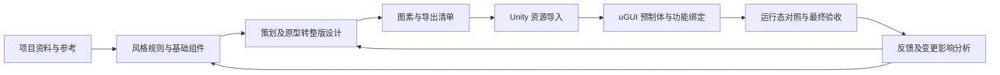

# SmartUI 通用游戏 UI 制作工具链总体规划

更新日期：2026 年 11 月 3 日。

实现基线：SmartUI Krita v0.4.0。

文档状态：总体规划初稿。本文汇总已经明确的目标与边界，提出后续阶段及验收要求；阶段安排属于规划，不表示功能已经实现或用户已确认具体技术方案。

## 1. 最终目标与使用方式

SmartUI 是通用游戏 UI 制作工具。用户按项目提供参考风格、策划文档、原型和工程约定，AI 完成参考分析、基础组件制作、整版设计、资源输出、Unity 导入及 uGUI 预制体生成，并根据反馈持续修改。

目标工作方式是 AI 执行制作与技术检查，人确认项目风格和最终效果。阶段之间的技术验收由工具和 Agent 执行，不额外增加逐步人工审批；必要输入缺失时，再提出具体问题。

首期在本机通过 Codex Plugin 使用现有模型和 Krita，优先把制作能力及交付正确性做实。以后再将稳定流程扩展为支持多项目、团队及不同模型分工的平台。专用模型或微调属于需要评估的能力路线，不作为当前本地工具开发的前置依赖。

全链路目标如下。图中包含尚未实现的阶段：

交付物应可编辑、可复用、可追溯，并能在目标 Unity 项目中运行和继续迭代。

## 2. 已明确的原则

| 原则 | 具体要求 |
| --- | --- |
| 工具通用，项目独立 | 工具仓库保存通用代码、Skill、接口文档、测试及可复用示例。具体项目的参考、规范、绘制程序、资产和运行记录留在各自项目中。 |
| 实际绘制 | 通过 Krita 原生笔刷、图层、蒙版及适用绘图接口制作，保存可编辑源文件；核心制作链路不依赖扩散生图或生成 Sprite Sheet。 |
| 画法属于项目 | 模型根据参考和需求编写项目绘制程序，工具提供程序维护、预检与执行能力，不将某种按钮、材质或固定图层结构写成通用要求。 |
| 一致性可复用 | 同类组件共用适用的几何、用色和绘制规则；换色、状态和尺寸变体显式表达差异，不靠每次重新猜测。 |
| 结果可检查 | 风格规则保留参考依据；资产记录实际程序、参数、版本和执行结果；技术通过、模型视觉评估、用户确认分别记录。 |
| 修改范围明确 | 根据反馈确定共用风格、单个组件或页面范围，预先识别受影响内容，避免局部反馈扩散到无关资产。 |
| 文档由工具维护 | 项目结构化数据是事实来源，风格和组件文档是其可读输出，避免聊天结论、文档和实际产物各自形成不同版本。 |
| 错误清楚暴露 | 缺少资源、非法配置、外部改动和执行失败给出明确原因，不静默替换笔刷、吞掉异常或自动重发不确定的绘制请求。 |
| 先完成本地流程 | 暂不先建设账号、计费、云端调度等平台功能。平台化从已经验证的制作流程中提取需求。 |

首个 Unity 对接方向已明确为 uGUI，包括 Canvas、RectTransform 和项目自研封装。Unity 6 及以上版本优先使用已安装的 Unity CLI；具体能力须在实际工程中验证，CLI 无法覆盖的操作再采用明确的工程内适配方式。所有 Unity 修改直接在用户当前项目目录与当前分支进行。

## 3. 当前实现与证据边界

| 能力 | 当前状态 | 尚未覆盖的内容 |
| --- | --- | --- |
| 本地 Plugin 与 Krita 连接 | 已实现，19 个 MCP 工具；v0.4.0 打包安装及四个新增工具的独立 MCP 调用已验证 | 尚无独立平台界面和团队协作 |
| 项目上下文及文档 | 已实现参考、风格、程序、组件和运行记录，以及自动生成的风格与组件文档 | 尚无策划、页面、导出资源、Unity 对象的完整关联模型 |
| 参考读取 | 已实现登记、预览、区域裁切、原像素取色 | 不包含自动语义识别、材质判断或可靠的字体反推 |
| 风格分析指导 | 已有 reference-style Skill，指导模型看图、归纳规则和记录依据 | 尚无系统化的跨风格复现质量验证 |
| 参考与产物对照 | 已实现指定参考区域与成功运行产物的裁切快照、等比缩放、并排图片及版本绑定；可通过 MCP 读取历史对照 | 不自动判断相似度、转换 ICC 色彩或推断两侧物理尺度 |
| 偏差反馈与复查 | 已实现观察、修改建议、节点及规则关联，以及追加式复查历史；上下文和组件文档同步展示 | 模型或用户提供视觉判断；反馈解决不代表用户风格确认 |
| 项目绘制程序 | 已实现 Python 源码保存、版本、读取、独立进程执行及计划预检 | 尚无模型自动选择、模型评测或完整任务调度 |
| 实际绘制 | 已实现原生笔刷、路径与形状、分组、绘画图层和透明度蒙版，保存 KRA 与 PNG 预览 | 不支持全部 Krita 节点；不保留完整自由手绘的逐点压力、倾角和时间信息 |
| 局部修改 | 已实现同文件内指定节点更新及未选节点检查 | 画布尺寸或图层结构变化暂需新组件 ID，不是任意结构编辑或自动合并人工改动 |
| 版本影响识别 | 风格、规格或直接引用的程序变化可使组件需要复核 | 尚无程序间、组件间、页面到 Unity 的完整依赖分析及自动重建 |
| 技术验证 | 已验证保存重开后的节点 UUID、属性和像素一致，及局部修改范围 | 不等同于风格还原、可用性或最终运行效果通过 |
| 用户确认 | 当前保留确认字段，但没有确认记录工具 | 不能将工具成功或模型评价自动转成用户确认 |
| 生产交付 | 当前可获得 KRA 和 PNG 预览 | 尚无正式切图、九宫格输出、图集管理、整版布局或 Unity 预制体交付 |

v0.4.0 自动测试为 301 项及 10 个子测试通过，包含真实 stdio MCP 的对照与反馈调用。v0.3.0 已完成组件绘制、自定义程序、循环笔触、蒙版及原文件局部修改的本机验证；本轮未重做 Krita 实机绘制。这些证据不代表模型能稳定完成任意参考风格，也不代表美术质量获得用户确认。

运行记录中的文件摘要用于追溯和相关操作校验，当前不是持续扫描所有资产的完整性监控。程序在本机独立进程执行，当前不是安全沙箱；共享平台若接受其他用户的程序，必须单独设计其执行边界。

## 4. 各层职责与数据关系

### 4.1 模型、Skill 和工具

| 层次 | 负责的判断或操作 |
| --- | --- |
| 模型 | 理解参考、策划和反馈，制定设计方案，编写项目程序，选择适用工具并评估视觉偏差 |
| Skill | 描述专业工作方法、证据要求、工具调用方式及交付标准；不把某个项目的画法变成全局模板 |
| 项目数据与程序 | 保存该项目的规则、资源、业务约定、可复用画法及制作历史 |
| 通用 MCP 工具 | 查询与更新状态，维护版本，校验和执行计划，返回真实结果及错误 |
| Krita 适配 | 将绘制计划落实为原生绘图操作和可编辑源文件 |
| Unity 适配（规划） | 将资源、页面结构和项目组件约定落实为工程资产、uGUI 层级及绑定 |
| 任务与模型调度（规划） | 在已定义的输入、输出和验收规则之间分配任务与模型，管理等待、失败及续作 |

现有程序可以输出不同图层结构和批量笔触。未来扩展通用绘图能力时，应根据真实制作缺口扩展操作接口，不要求工具预先理解所有材质和组件类型。

### 4.2 需要贯通的项目对象

以下关系是目标数据模型；当前仅实现其中参考、风格、绘制程序、组件和执行记录部分。

| 对象 | 应保留的内容与关联 |
| --- | --- |
| 项目描述 | 项目用途、目标平台、分辨率与语言要求、UI 框架及自研组件约定 |
| 参考与风格 | 参考来源、区域证据、观察与假设、适用范围、共用参数、版本及确认记录 |
| 基础组件 | 语义用途、交互状态、内容区域、尺寸规则、伸缩限制、程序和可编辑源文件 |
| 策划及原型 | 来源与版本、页面流程、数据字段、交互行为、状态和待确认事项 |
| 页面设计 | 语义节点、布局关系、组件实例、动态内容、交互区域及视觉预览 |
| 图素 | 稳定资源标识、来源节点及版本、导出区域、偏移、透明边界、伸缩边界和文件 |
| Unity 交付 | 工程资产引用、导入设置、预制体节点映射、组件与行为绑定、生成和运行验证记录 |
| 反馈及执行记录 | 修改原因、目标范围、输入版本、实际操作、结果、影响对象及用户确认 |

项目风格文档与组件文档继续作为长期维护的两个基本入口。页面、资源和工程绑定说明按后续需求增加，不把所有信息塞进风格文档；这些内容都属于使用工具的项目，不进入工具仓库。

### 4.3 三种结构必须区分

Krita 图层表示绘制和编辑关系，页面语义结构表示内容和交互关系，Unity Hierarchy 表示运行时对象关系。三者应建立映射，但不要求一一对应。例如，一个按钮可以有多个绘画层，导出一个可伸缩背景图素，在 Unity 中由背景、动态文字和点击组件组成。

整版设计开始前就要定义最小布局与资源交付约定，使预览、切图和工程生成共享相同的组件身份与布局依据。动态文字、列表内容和交互热区应明确记录，不能只存在于整张位图中。

## 5. 分阶段推进与验收

阶段顺序以依赖关系为依据，不是工期承诺。当前优先推进阶段一；后续阶段先有总体边界，临近实施时再补充必要的接口和数据设计。

| 阶段 | 核心交付 | 进入下一阶段的依据 | 当前状态 |
| --- | --- | --- | --- |
| 阶段零：工具执行基础 | 本地 Plugin、项目存储、原生绘制、项目程序、保存及修改验证 | 实际文件可编辑、操作可追溯、错误可定位 | v0.3 已验证基础能力 |
| 阶段一：参考风格到确认样片 | 有依据的风格规则、模型编写的项目程序、组件样片及对照反馈 | 风格获得用户确认；至少一个变体遵守共用规则；画法和参数由项目程序及项目数据承载 | 对照与反馈工具已实现；真实样片质量和风格确认仍待验证与补齐 |
| 阶段二：基础组件库 | 代表页面所需组件、状态与变体、尺寸和伸缩规则、编辑及复用记录 | 组件可以复用和局部修改，所需状态和内容区域明确 | 未实施 |
| 阶段三：策划与原型到整版设计 | 页面语义及布局描述、组件实例、必要设计层级和整版预览 | 代表页面覆盖策划流程，动态内容与交互结构明确，可交给导出和 Unity 阶段 | 未实施 |
| 阶段四：切图与图素管理 | 可重复的导出任务、图素清单、元数据和变更记录 | 资源身份稳定，导出正确，共享资源更新不产生错切、重复或失联 | 未实施 |
| 阶段五：Unity 交付 | Sprite 资源、导入设置、uGUI 预制体、自研组件适配及约定的功能绑定 | 在真实工程中通过画面、层级、引用和运行态检查 | 未实施 |
| 阶段六：全链路增量维护 | 变更影响分析、按需重建、跨阶段追溯和回归检查 | 局部反馈可传播到工程，无关内容及有效引用保持稳定；用户确认实际最终效果 | 未实施 |
| 阶段七：平台与模型分工 | 项目工作台、任务编排、模型能力接口和后续团队使用能力 | 多项目隔离，任务可续作，模型选择有质量、成本与速度依据 | 未实施 |

### 阶段一：验证模型的风格理解与自主绘制

利用现有工具从真实参考开始，让模型记录规则、编写项目程序、制作样片、查看实际产物并依据偏差修改。先完成样片质量验证，再依据缺口补工具；不把再次运行已有示例当作模型重新理解参考的证明。

这一阶段需要形成：

- 可追溯的规则：例如用色关系、轮廓、边厚、亮暗分区、适用材质和伸缩行为，明确证据与假设。
- 同尺度的参考与产物对照，以及可操作的偏差记录；颜色和几何统计可以辅助判断，但不能代替视觉评估。
- 样片、至少一个共用规则的变体、一次原文件局部修改，以及对应程序和实际版本。
- 用户风格确认的记录方式，将确认绑定到具体风格版本和样片；当前尚缺此工具能力。
- 一份流程测量：模型调用次数、总耗时、程序执行与绘制耗时、人工介入和修改轮次，避免仅用单批笔触耗时评价整体效率。

在宣称具有通用复现能力前，建议至少使用另一组视觉特征明显不同的参考重复验证。测试输入留在各自项目；工具测试只保留独立可用的合成资料和通用行为验证。某个材质不适合当前接口时，明确其缺口，再决定补充笔触接口、改进模型工作方法或评估专门模型。

本轮补充的通用能力：

- `project_compare_component` 保存参考区域、指定运行的产物区域、各自显示倍率和原像素裁切快照；`project_get_comparison` 校验并返回已保存的图片及关联反馈。两端分别等比缩放，视觉比较前由模型选择适用区域和尺度。
- `project_record_feedback` 保存具体观察与修改建议，并关联该次运行中的节点及风格规则；`project_update_feedback` 追加解决、不处理或重新打开的理由。解决偏差必须关联同组件、同参考区域且晚于原始运行的成功产物对照。
- 项目上下文区分对照是否对应当前运行，以及反馈复查结论是否适用于当前运行。新绘制不会自动关闭旧反馈；历史结论和图片保持原始版本。组件文档同步展示这些记录。
- reference-style 与 krita-drawing 两项 Skill 指导模型实际查看对照、记录偏差、修改项目程序或参数，再依据新对照复查。工具负责保存和校验，视觉判断仍由模型执行。

本轮采用合成图片和运行快照验证通用行为，并通过实际 stdio MCP 进程检查图片返回、反馈写入及跨会话恢复；合成运行记录不代表 Krita 重新实机验收或参考风格质量通过。用户风格确认接口、真实样片及变体的视觉验收、完整流程效率测量仍是阶段一的后续工作。

### 阶段二：形成能复用的基础组件库

先选定一张贯穿后续阶段的代表页面，再从其实际需求选择组件，不预设所有游戏都需要相同组件目录。区分可复用组件、装饰元素、图标和内容槽位；按用途记录正常、禁用、选中等实际需要的状态。

同类组件明确哪些参数共享，哪些允许实例覆盖。尺寸变化需要说明固定角部、边厚、内容留白、可拉伸区域和最小尺寸；计划支持九宫格时，验证边角与中心区域的行为。标签文字、字体资源和动态内容区域要独立于背景图素管理。

按实际编辑任务补充结构修改能力，例如增加或移除图层、调整分组或画布尺寸，并保持仍然有效的节点身份及后续引用。当前限制须显式保留在文档中，不能把所有结构变化都包装为普通局部更新。若现有接口已经满足这一轮组件制作，不为假想需求先扩展全部 Krita 功能。

### 阶段三：从需求形成可交付的整版设计

接收策划文档和原型，提取页面、流程、数据字段、状态和操作，并保存来源与版本。设计节点应能追溯到相应需求，使后续导出与工程生成也能读取页面用途及交互要求。

在复用组件的基础上生成布局与设计层级，记录定位、尺寸、锚点或布局约束、层级关系及动态内容。制作必要的独立装饰和新组件，并把可复用部分补回组件库。

沿用阶段二选定的代表页面，用同一份页面描述贯穿设计、切图和 Unity 交付。预览应从该结构及资产生成，使后续工程生成有可执行的布局依据。Krita 编辑层与页面运行节点分开组织，文字、列表或按钮行为不因预览栅格化而丢失。

阶段开始前明确坐标单位、参考分辨率、缩放策略、资源标识、动态内容和状态表达。具体布局格式及预览实现留待该阶段设计，不在本规划中虚构已经存在的布局引擎。

### 阶段四：导出和维护图素

为组件或页面节点定义导出范围，输出正式资源及清单。PNG 预览不能直接被当作已经完成的生产切图。

清单至少能表达资源身份、来源节点和版本、透明边界、裁切偏移、尺寸及适用的轴心和九宫格边界；字体、图标和图像按实际类型保留所需信息。导出后检查尺寸、透明度、边缘、伸缩结果及页面重组效果。

更新同一图素时保持其身份和预期路径；共享图素的引用关系可查询。图集策略、压缩和分辨率策略由目标工程需求决定，不写成所有项目的固定参数。无引用资源清理必须单独识别，不能在普通导出中顺带删除。

### 阶段五：Unity 导入、预制体和功能绑定

先读取目标工程的 Unity 版本、uGUI 组织方式、资源目录、字体与图集约定、自研组件、加载方式及绑定约定。将这些差异写成项目适配描述；通用工具不硬编码某个工程的脚本类名和目录。

通过适用的 Unity CLI 或工程内编辑器接口完成资源导入和预制体生成。根据页面语义和布局建立 Canvas/RectTransform、图像、文字、交互与布局组件；按项目约定决定分组、复用子预制体及绑定方式，不把绘画图层机械复制成 Hierarchy。

需要对接的功能包括约定的数据字段、点击行为、状态变化和现有脚本引用。UI 接线不等于自动实现未知业务系统；缺少目标 API 或行为定义时，要明确列出缺口。代表页面的已明确交互必须在真实工程中验证，不能仅凭序列化字段存在判定成功。

验收覆盖工程编译、资源引用、层级结构、实际分辨率和必要的动态内容、交互与布局。将 Unity 实际渲染和设计预览对照，检查字体、缩放、描边、九宫格和位置偏差。仅验证项目需要的平台、分辨率及语言，不任意扩大矩阵。

### 阶段六：持续修改与全链路一致性

将直接的程序到组件关系扩展到风格、组件、页面、图素和 Unity 产物。区分内容、几何、结构和行为变更，列出影响范围，再执行需要重建的部分。

至少验证一次完整修改链：修改一个组件 → 更新源文件 → 导出对应图素 → 更新 Unity 资产与页面 → 检查实际效果。相同资源保持 Unity GUID（资产标识）和有效引用；无关页面、节点及已建立的绑定保持不变。重复导入相同输入不产生重复资产或多余节点。

代表页面完成技术检查与修改验证后，向用户展示 Unity 中的实际最终效果，记录用户确认及其对应的风格、页面、资产和预制体版本。这是最终效果确认节点。后续变更若影响已确认效果，按明确的项目规则更新确认状态；无关变化不应自动使所有确认失效。

保留实际版本和变更原因，明确工具管理与人工维护区域。外部修改发生时先报告差异；人工改动接纳、重建或合并需要明确规则，不能将目前的拒绝覆盖机制描述为已实现自动合并。失败保留执行证据，只有能确定完成状态后才能继续，不增加盲目重试。

### 阶段七：平台化与模型分工

本地流程完成后，再提供项目入口、任务状态、产物预览、反馈和风格/最终效果确认界面。阶段结果与待办应持久化，使任务交接不依赖某次聊天记忆。

可按实际效果将参考分析、需求理解、绘制程序编写、视觉评估和工程生成交给不同模型。先统一这些任务的输入、输出、上下文来源和验收方式，再实现选择与调度；不预设每一步必须使用不同模型。

从前面阶段持续收集失败类型、修改过程和质量指标，用于评估现成模型、专门模型或微调是否有必要。模型来源、训练数据和运行方式在有实测依据后确定，不承诺现有宿主支持任意模型微调，也不承诺微调必然解决工具接口缺口。

团队协作、权限和不可信程序执行隔离在开放多人使用前单独设计。工具仓库仍不收录用户项目数据、训练样本或项目资产。

## 6. 贯穿各阶段的验收标准

| 维度 | 应回答的问题 |
| --- | --- |
| 视觉质量 | 与参考相比具体差异在哪里？是否符合项目规则？风格及最终效果是否由用户明确确认？ |
| 变体一致性 | 换色、尺寸和状态变化是否保留应共享的结构？是否出现规则漂移？ |
| 可编辑性 | 源文件、图层和项目程序能否继续修改？未选内容是否保持不变？ |
| 技术正确性 | 文件是否真实存在并通过所需检查？错误是否明确？工程资源和对象引用是否有效？ |
| 可追溯性 | 结果使用了哪个参考、规则、程序、参数和需求版本？旧结果是否保持其实际版本？ |
| 更新稳定性 | 局部变化是否只影响必要范围？重复执行和导入是否保持资产身份及有效绑定？ |
| 效率 | 总耗时、模型调用、绘制及文件操作耗时分别是多少？人工干预和返工来自哪里？ |
| 通用性 | 更换项目风格或工程约定时，是否通过项目数据和适配完成，而非修改工具里的专用画法？ |

质量、速度和成本阈值应依据阶段一的测量及用户期望制定。当前没有足够依据写死“任意风格均可复现”或具体完成时长。自动测试验证当前需求；需求改变时更新或删除过时测试，不为旧实现保留无必要的兼容分支。

## 7. 尚需决策的事项

以下事项在进入相应阶段前收敛，不阻碍先保存本规划，也不作为现在立即开发全部能力的要求。

| 事项 | 决策时机与依据 |
| --- | --- |
| 首轮风格质量标准与第二组验证参考 | 阶段一，根据样片偏差和用户风格确认确定 |
| 何种手绘效果必须补充笔触或节点接口 | 阶段一至二，以真实参考和编辑需求为依据 |
| 字体、笔刷等资源的可复现登记方式 | 阶段一至二，明确实际依赖及缺失时报错方式 |
| 风格确认与最终确认如何记录、何时失效 | 阶段一先定义风格确认，后续关联具体资产和页面版本 |
| 页面布局描述及预览方式 | 阶段三开始前，与导出及 Unity 最小输入约定一起确定 |
| 图集、导入设置及稳定身份规则 | 阶段四至五，根据目标工程约定确定 |
| 自研 uGUI 封装、绑定和工程生成边界 | 阶段五前，读取实际工程和可用 Unity CLI 能力后确定 |
| 人工改动与结构调整如何保留 | 有实际编辑需求时明确，不能以自动覆盖代替设计 |
| 模型分工与专门训练 | 根据前面阶段记录的质量、速度、成本和失败类型决定 |

## 8. 后续工作与文档维护方式

以 v0.4.0 作为首轮项目试用基线，暂缓主动扩展工具功能。下一工作项继续限定为阶段一：使用现有工具完成真实参考到样片及变体的制作、原文件局部修改和视觉复查，并测量完整制作流程。

使用中区分模型判断、Skill 指导、项目程序和工具能力的问题。阻断制作的工具问题及时修复，其余需求记录后统一评估优先级；用户确认记录等尚缺能力也按实际使用需要安排。项目资料与产物留在各自项目中，工具仓库只维护通用改动。

开始每个工作项时，在任务说明中交代它属于哪个阶段、解决哪个缺口、交付什么、如何验收。只为当前阶段补充必要的设计，不提前写完整平台和所有后端的详细接口。

完成后更新本文件的实现基线、状态表和验收结论；工具参数以对应接口文档为准，避免两处维护同一份详细 schema。若实际需求改变阶段顺序、范围或架构选择，先更新规划说明，再继续实现。

本轮只补充通用对照、反馈及相关 Skill；验证资料由测试临时生成，具体项目数据保持独立。规划、代码和文档不自动暂存或提交。

相关文档：

- [当前安装、使用与能力说明](../README.md)
- [项目工具与执行记录](project-tools.md)
- [项目 Python 绘制程序约定](drawing-programs.md)
- [参考风格分析与项目绘制程序复现验证流程](style-reproduction-validation.md)
- [Krita 底层接口约定](bridge-contract.md)
- [参考风格分析 Skill](../skills/reference-style/SKILL.md)
- [Krita 制作 Skill](../skills/krita-drawing/SKILL.md)
