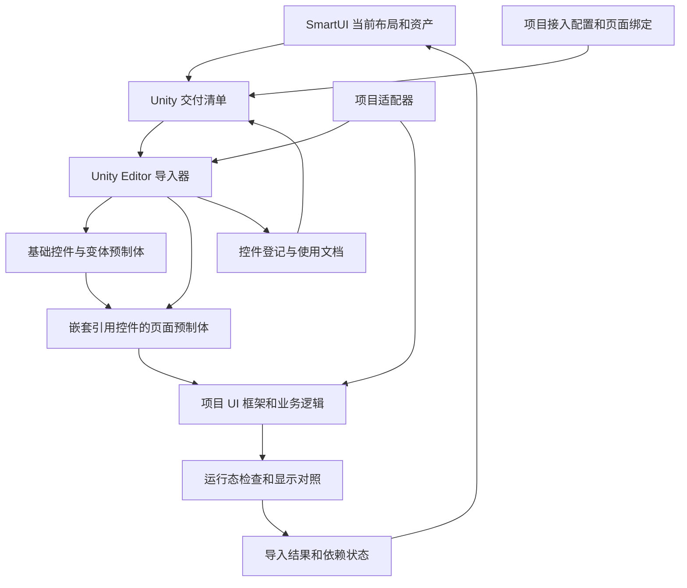

# Unity uGUI 接入工具链设计

SmartUI PhotoCraft v0.14.0 已提供控件目录、制作定义、正式页面控件预览、Unity CLI 调度和通用 uGUI Editor 构建包。基础预制体、变体及页面嵌套的工具链实现已具备，真实工程尚待选择并验证。运行时布局、完整字体效果和业务适配仍属后续范围。当前接口见 [Unity 接入工具](unity-tools.md)，具体边界见[预制体复用方案](unity-prefab-reuse-plan.md)。本文承接[总体规划](toolchain-roadmap.md)中的资源交付、Unity uGUI 和工程端持续维护。

接入目标是把 SmartUI 的页面设计变成可以接入项目框架、响应运行时内容变化、保留业务引用并持续更新的 uGUI 预制体。建议采用“设计数据导出、Unity 导入器、项目适配器”三部分：设计数据表达布局和资源语义，导入器管理资源与对象更新，项目适配器接入具体控件、字体、本地化、加载和业务绑定。

基础控件库是页面制作的前提。项目文档维护已构建的控件、实际预制体及使用约定，页面版式通过嵌套预制体复用它们。共用修改更新基础预制体，由继承关系传播到实例；页面只保存自身排布及明确允许的差异，不复制维护控件内部结构。

第二阶段先打通一个代表控件的构建、登记、两个页面中的嵌套使用和共用修改。对象身份、继承关系和更新边界从第一次导入就建立；页面运行时布局、交互和整页验收逐步扩展。具体制作输入、保存流程、验证工程条件和验收用例见[基础预制体和页面嵌套复用实施方案](unity-prefab-reuse-plan.md)。

## 1 当前基础与接入缺口

| 范围 | 可复用的当前能力 | Unity 接入需要补充的内容 |
| --- | --- | --- |
| 页面身份与结构 | `layout_id`、整页唯一的 `node_id`、有序分组树、图像和文字节点 | Unity 对象映射、控件语义、生成范围、宿主挂载位置 |
| 资源与几何 | `asset_id`、真实文件与摘要、内容框、五种伸缩模式、正式导出来源 | Sprite 导入设置、像素单位转换、稳定 GUID、资源注册与图集规则 |
| 布局 | 绝对定位、行、列、叠放、内边距、间距、`fill`、`content`、安全区和基线 | Unity 实际尺寸与文字测量、运行时重排、布局属性的控制权 |
| 文字 | 角色 ID、源字体摘要、字号、行高、字距、填色、描边、投影及溢出策略 | TextMeshPro 字体资产和材质、本地化入口、缺字检查、目标端排版与效果校准 |
| 组件使用 | 文字范围、命中范围、枢轴和必需状态名称 | 控件类型、状态到具体资产的映射、事件和数据绑定、动画目标 |
| 控件目录与复用 | 独立控件目录、文本预制体身份和文件核对、公开槽位、静态清单实例、变体及嵌套依赖 | 浏览器布局的控件引用、Unity 导入、继承效果及运行检查 |
| 依赖与更新 | 来源过期检查、页面依赖查询、显式重建、revision 并发检查 | Unity 端导入基线、人工改动冲突、项目资源依赖、更新后引用与运行行为检查 |
| 预览与检查 | Chromium 页面、PNG、静态布局测量及场景变体 | Unity Play Mode、实际交互、目标平台及设备显示验收 |

当前页面只有 `image`、`text`、`group` 三种节点，`group.component_id` 只引用组件使用规格，尚不表示 Unity 控件实例。组件的 `required_states` 只列出状态名，并不指定哪个图像节点使用哪份状态资产，也没有切换逻辑。同组件可能登记多个同名状态的资产，因此不能据此自动构造按钮状态机。

当前接入清单引用控件登记和制作来源，并接收独立提供的实例矩形和绑定键。浏览器构建把 `content` 变成测量宽度、把 `fill` 变成具体尺寸，并应用视觉偏移，文字缩字和基线调整在后续渲染时发生。其快照适合作为指定条件下的视觉对照。后续接入运行时布局时需要保留原有约束及测量规则。当前实现依据见 [page_layouts.py](../smartui_mcp/page_layouts.py)、[layout_constraints.py](../smartui_mcp/layout_constraints.py)、[component_usage.py](../smartui_mcp/component_usage.py) 和 [page_builds.py](../smartui_mcp/page_builds.py)。

## 2 工具与工程的职责

下图描述完整工具链的目标。当前实现到交付清单准备，Unity Editor 导入及其后的环节属于后续计划。



| 部分 | 负责的工作 | 交付位置 |
| --- | --- | --- |
| SmartUI Python 与 MCP | 当前维护控件登记和使用文档、校验来源、生成清单并报告页面输入或依赖的变化；后续查询工程同步影响并发起明确的 Unity 操作 | 通用实现维护在工具仓库，项目控件目录与交付清单保存在业务项目 |
| Unity Editor 包 | 检查工程能力、构建独立控件预制体、在页面中嵌套实例、按归属更新对象、保存映射及验证引用 | 通用 Unity Package，Editor 与 Runtime 程序集分离 |
| 必需的运行时组件 | 执行明确声明的布局、文字策略、命中或状态显示；响应实际内容变化 | Unity 包的 Runtime 部分，只引入使用到的能力 |
| 项目适配器 | 对接宿主层、控件工厂、字体材质、本地化、资源加载、业务字段与动画 | 业务工程中的 C# 适配代码及配置 |
| Skill | 指导读取控件目录与工程约定、选择已有控件、维护新增控件、嵌套组版及定位反馈 | 工具仓库的通用接入 Skill |

通用实现随工具一起维护。初期可用本地 Unity Package 验证，发布时再确定团队可安装的包来源和版本锁定方式。业务工程不能依赖开发者机器上的绝对路径；项目适配器和具体页面数据不进入工具仓库。

普通页面预制体接入项目已经存在的 Canvas、层管理、EventSystem 和加载入口。只有项目配置明确要求时才创建这些宿主设施。首期目标是 uGUI；UI Toolkit、世界空间 UI、任意既有预制体反向还原设计及双向自动合并另行确定范围。

## 3 接入配置与交付协议

### 基础控件目录与使用文档

为 Unity 可复用控件设立独立的 `control_id`。PhotoCraft 的 `component_id` 标识视觉制作来源，两者不要求一一对应：一个按钮控件可以组合背景、图标、文字、状态和交互组件，也可以与其他控件共用同一份视觉资产。复合控件可以继续嵌套基础控件，登记其依赖并拒绝循环引用。

项目维护一份可读、可校验的控件目录。下表描述完整接入所需信息，当前具体字段以工具协议为准。

| 资料 | 要回答的问题 |
| --- | --- |
| 身份与用途 | 控件 ID、名称、适用场景和当前预览；是否有可直接复用的控件 |
| 实际产物 | 基础预制体的 GUID、工程相对路径、来源资产和当前构建摘要；哪些已构建、哪些仍是设计 |
| 公开槽位 | 文字、图标、内容容器、事件和数据接口的稳定槽位 ID、类型及必需条件；页面从哪里接入 |
| 布局约定 | 支持的尺寸范围、伸缩方式、内边距、文字范围、命中范围和动画中心 |
| 实例参数 | 哪些文案、图标、状态选择和业务引用允许由页面提供；哪些共用属性必须继承 |
| 变体与组合 | 变体的基础控件、明确的差异，以及复合控件使用的基础预制体 |
| 使用位置与验证 | 被哪些控件、变体和页面实例引用；当前导入、运行检查和视觉确认分别处于什么状态 |

项目工具在 `smart-ui/unity/registry.json` 维护结构化控件记录，生成 `smart-ui/docs/unity-controls.md`。登记有独立的 revision，使用约定通过工具更新。已有预制体可按工程相对路径和 GUID 登记，核对文本对象标识、公开槽位对象和直接源预制体引用。实际导入结果将在工程接入阶段记录。

构建或登记控件后更新其目录；创建版式前先查询目录，按尺寸、槽位和状态要求选择已有控件；缺少所需控件时先定义并构建，再供版式引用。已有人工制作的预制体可以显式登记，其内部结构仍按已声明的归属维护，不因登记而自动接管。需要浏览器预览时，还须有对应的设计定义或明确的预览资料，不能假定能够反向还原任意预制体。

目录描述当前资料，历史由 Git 保存。资源缺失、产物摘要变化、公开槽位失效或文档登记不一致时，报告具体控件及原因；技术检查、运行检查和用户视觉确认分开记录。

### 页面以控件实例组版

页面语义需要补充控件实例引用，记录所用 `control_id` 或变体、稳定实例 ID、外层布局，以及文案、图标等明确传入的设计参数。工程内的数据字段、本地化键和回调则由独立接入绑定按实例 ID 和公开槽位 ID 提供。控件内部的图文结构由控件定义维护；浏览器构建可以按引用展开计算，页面源资料不保存一份重复的内部节点树。该能力需要扩展当前布局 schema 和依赖查询，尚未实现，不能把现有 `group.component_id` 当成已经具备这一能力。

Unity 导入先完成被引用的控件，再在页面中实例化其预制体并保留嵌套连接。页面导入不得解包、克隆成无连接的对象树，或把用于浏览器预览而展开的图文再次生成成一套对象。Unity 的嵌套预制体会保留到各自源预制体的连接。[Unity 嵌套预制体](https://docs.unity.com/en-us/engine/6000.0/manual/working-with-gameobjects/prefabs/nested)

基础预制体维护内部结构、共用外观、状态显示和控件行为；页面维护外部排列及公开参数。例如，多个版式嵌套同一个主按钮预制体，各自传入按钮文案和业务绑定，共用描边、阴影和状态显示仍由按钮预制体维护。

### 实例覆盖与预制体变体

控件目录列出允许实例修改的字段，页面只写明确传入的参数。没有传入的属性保持继承，即使其当前值与基础预制体相同，也不能为了完整序列化而创建覆盖。共用的内部图像、字体样式、状态资产和结构默认由控件维护；需要暴露某项差异时，先在控件使用约定中声明其含义和范围。

Unity 的实例覆盖优先于源预制体，同一属性被覆盖后不会跟随源值变化。实例根 RectTransform 的位置、尺寸等还具有对齐方面的特殊行为，因此优先让页面自有的布局容器承担外部排列；必须设置控件根属性时明确归属，并单独验证尺寸变化，不能承诺基础根尺寸会自动传播到所有页面。[Unity 实例覆盖规则](https://docs.unity.com/en-us/engine/6000.0/manual/working-with-gameobjects/prefabs/override/prefab-instance-overrides)

多处复用的外观差异可建立并登记 Prefab Variant（预制体变体），页面嵌套该变体。变体保存相对于基础预制体的明确差异，页面再保存相对于所选变体的实例参数。一次性的文案或业务引用通常作为实例参数处理，不为每个页面新建变体。[Unity 预制体变体](https://docs.unity.com/en-us/engine/6000.0/manual/working-with-gameobjects/prefabs/prefab-variants)

页面同步不向基础或变体执行 Apply All，也不通过 Revert All 清除差异。工具只处理归自己管理的具体字段和覆盖记录；未声明的人工覆盖按冲突报告。若差异应升级为共用规范，显式修改控件或变体，再更新其目录和验证结果。

### 项目配置和页面绑定

配置分为项目级和页面级。项目级配置统一描述控件、资源及宿主约定；页面级绑定用稳定节点 ID 表达该页的实际用途。逻辑语义与 Unity 类名分开，避免为了适配另一个工程而改写设计树。

页面绑定独立保存，只补充运行用途和工程映射，不另存一套布局坐标或覆盖设计样式。引用不存在的节点、资产、角色或不适用的属性时明确失败；不向当前页面节点直接塞入未经 schema 定义的 Unity 字段。

| 配置 | 必须明确的内容 |
| --- | --- |
| 工程与宿主 | 工程标识、目标包版本、Canvas 模式与设计单位、挂载入口、安全区由谁提供 |
| 输出范围 | 资产和预制体目录、可更新的对象与属性、复用已有资源的显式引用 |
| 控件类型 | 逻辑类型对应的基础预制体、变体及公开槽位；组件工厂用于控件构建，不在每个页面重复生成控件子树 |
| 文字角色 | 角色和语言对应的 TMP Font Asset、材质、源字体一致性及字符覆盖要求 |
| 资源策略 | Sprite 导入参数、图集归属、包或地址注册、运行时加载约定 |
| 页面绑定 | 按实例和公开槽位指定工程数据字段、文本键、回调及动画入口；共用状态到资产的映射留在基础控件或变体，页面只提供约定允许的参数 |

配置中的资源文件用 Unity GUID 或工程相对路径定位，并校验类型；一个文件包含多个 Sprite 等子资源时，还必须使用 local fileID 或预检解析后固定的等价子资源标识。路径和类型相同不能消除子资源歧义，不按显示名称模糊寻找。页面节点 ID 不通过大小写折叠或改名来推断身份。未声明交互的装饰节点不自动变成按钮；声明为按钮却缺少必需映射时明确报错。[Unity 资源与子对象标识](https://docs.unity.com/en-us/engine/6000.0/script-reference/unityeditor/assetdatabase/trygetguidandlocalfileidentifier)

页面 `background` 在接入配置中明确作为实际背景图形交付，或仅作为预览环境色。前者生成对应图形，后者由宿主场景提供对照环境；不能未经声明给每个页面增加全屏不透明底板。

### 交付清单

当前清单由 `project_prepare_unity_handoff` 生成，保存协议版本、项目与适配器标识、来源 revision、静态页面实例、所用控件及依赖、资源和两类页面签名。工具核对来源及预制体文件，清单的 Unity 验证状态为 `not_performed`。完整接入拟扩展以下数据职责。

| 数据段 | 内容与用途 |
| --- | --- |
| 协议与输入 | 协议版本、工具版本、项目标识、来源 revision、配置与适配器版本或摘要 |
| 页面 | 页面 ID、原始有序节点树、设计尺寸、安全区语义、布局与文字策略 |
| 控件与实例 | 控件定义及预制体身份、共用状态映射、变体关系、公开槽位、允许的覆盖、页面实例引用和设计参数 |
| 资产 | 资产 ID、工程相对来源路径、文件 SHA-256、真实像素尺寸、几何和来源摘要 |
| 文字 | 角色 ID、字体文件摘要、设计样式、目标字体与材质绑定 |
| 工程绑定 | 页面实例及公开槽位对应的项目数据字段、本地化键、事件回调和适配器入口 |
| 验证场景 | 本次选择的屏幕、文案、数值、语言和状态，以及对应设计对照的摘要 |
| 依赖签名 | 分开记录本对象的直接输入和传递依赖；直接输入用于计划写入，传递依赖用于继承检查及显示复验 |

资产集合从当前图像登记中解析。单个组件的最近一次导出清单可能只包含本批次重新导出的状态，不能把未在该批次出现的有效资产当成已删除。所有选用状态资产都要检查真实文件、几何和来源，并进入依赖签名。

现有页面读取接口返回的 `revision` 是读取时的项目 revision，不能当成历史构建的来源版本。Unity 导出须另存本次读取的来源 revision 和实际依赖摘要；无关项目资料变化可以触发并发复核，但不应迫使所有预制体重写。相关当前行为见 [projects.py](../smartui_mcp/projects.py)、[exports.py](../smartui_mcp/exports.py) 和 [page_dependencies.py](../smartui_mcp/page_dependencies.py)。

当前交付清单保存在业务项目的 `smart-ui/unity/handoffs/`，登记的预制体位于 `Assets/`。后续工程接入产生的稳定对象映射及上次成功导入的受管属性基线需要随工程保存，临时计划、截图和诊断放在 `.smartui/` 或工程规定的本机目录。清空缓存后仍应能判断受管范围和继续更新。

控件的构建输入覆盖其自身资产、样式和实现；页面的直接输入覆盖实例选择、排列和显式参数。基础预制体内容变化属于页面的传递依赖变化，不应仅因合并摘要改变就计划重写所有页面。依赖关系仍须完整保存，用来确定哪些版式需要复验。

## 4 图像几何与坐标转换

### 内容框与显示范围

SmartUI 的内容框、完整 PNG、可见像素和命中区有不同含义。推荐为内容布局保留逻辑 RectTransform，再用子节点显示完整图像；图像子节点按已有 `image_patches` 的 `image_size` 和 `content_offset` 定位。命中节点和必要的动画节点按控件语义独立设置，不按 PNG 透明边重新推算。几何定义沿用[资源伸缩几何](asset-geometry.md)。

例如，内容框左侧有 7 像素外扩，九切片后的图像仍从内容框左侧 7 个设计单位处开始绘制。不能把完整 PNG 直接压入内容框，否则主体、阴影和文字对齐都会变化。

### 坐标和像素单位

设计坐标以左上角为原点，向右、向下为正。对无旋转、单位局部缩放、左上固定锚点的子节点，若其相对父节点的内容框是 `(x,y,w,h)`，设计枢轴是 `(px,py)`，可转换为：

```text
anchorMin = anchorMax = (0, 1)
pivot = (px, 1 - py)
sizeDelta = (w, h)
anchoredPosition = (x + px * w, -(y + py * h))
```

以上要求一个设计单位等于一个 Canvas 逻辑单位；有其他单位比例时，先统一换算长度。`x`、`y` 已包含一次父级内边距，不重复叠加。伸缩锚点和受运行时布局驱动的节点由对应布局控制器设置，不能机械套用静态公式。枢轴改变时保持内容框位置，动画缩放才不会改变初始排版。

Sprite 切片边距使用 Unity 的 `(left, bottom, right, top)` 顺序。设计中的上、下边距必须正确交换位置。[Unity spriteBorder](https://docs.unity3d.com/cn/6000.0/ScriptReference/TextureImporterSettings-spriteBorder.html)

项目配置明确 Sprite 的 Pixels Per Unit（每单位像素数）、Canvas 的 `referencePixelsPerUnit` 和 Image 的 `pixelsPerUnitMultiplier`。一个设计像素等于一个 Canvas 单位时，可令前两者相同、后者为 1；已有工程采用其他值时必须换算。CanvasScaler 还会把逻辑单位缩放到实际屏幕，不能重复乘入设计几何。[CanvasScaler](https://docs.unity3d.com/Packages/com.unity.ugui@2.0/manual/script-CanvasScaler.html)

| 模式 | Unity 显示策略 |
| --- | --- |
| `contain` | 先按内容框等比居中，再设置完整图像子节点的范围；不对已经计算好的完整图像再次执行等比适配 |
| `stretch` | 内容和外扩分别沿两轴使用同一缩放比例，图像子节点按计算后的范围显示 |
| `nine_slice` | 使用完整图像范围和 Sprite border，保持外扩及固定边；检查目标中心为正 |
| `horizontal` / `vertical` | 按声明设置单轴切片，另一轴保持原尺寸；运行时尺寸变化也遵守此约束 |

Unity 原生 Sliced Image 在尺寸不足时可能压缩边框；SmartUI 的约定要求中心严格为正，必须在导入及运行时布局检查中拒绝非法尺寸，不能用 Unity 的压缩结果代替校验。[uGUI Image 实现](https://github.com/Unity-Technologies/uGUI/blob/main/com.unity.ugui/Runtime/UGUI/UI/Core/Image.cs)

基准导入采用可保持完整矩形和源像素几何的设置。自动裁透明边、纹理缩小、图集旋转或紧密打包均不能未经核对便启用。项目需要压缩、图集或平台缩放时，将其作为显式资源策略验证，并检查最终纹理尺寸、切片和透明边，而不是只检查 PNG 文件。

## 5 布局与文字的运行时适配

### 布局关系保留到 Unity

固定布局可直接生成 RectTransform。控件实例的外层排列由页面负责，控件内部布局由基础预制体负责，页面通过公开的尺寸和内容参数驱动它。含 `fill`、`content`、基线或动态文案的布局必须保留关系，在父级尺寸、文案、语言或状态变化时重新测量和排列。浏览器提供对应场景的设计参照；Unity 使用实际字体和宿主尺寸计算运行结果。

不预设所有规则都能直接映射为 HorizontalLayoutGroup、VerticalLayoutGroup 或 ContentSizeFitter。现有规则包括等分余数的顺序、视觉偏移和基线对齐，应逐项验证。建议实现一个范围有限的布局执行器，复用当前约束语义；项目已有等价实现时由适配器接入。原生组件只有通过等价验证的规则才直接使用，不叠加两套控制器争写同一属性。

Unity 布局组件会重新写入其驱动的 RectTransform 属性，因此导入器应写布局输入，而不是持续修正计算结果。[uGUI 自动布局](https://docs.unity3d.com/Packages/com.unity.ugui@2.0/manual/UIAutoLayout.html)

布局实现以纯几何样例检验跨语言一致性，明确设计单位的量化与余数规则；源图切片位置允许保留既有的小数。TMP 提供文字实际宽度和基线等度量，不能要求它与 Chromium 的栅格化逐像素一致。一次重排按“测量内容、分配空间、处理文字、对齐和检查”的明确顺序完成，避免每帧无条件重建和重复订阅事件。

普通分组不自动添加 Mask 或 RectMask2D，图像的阴影和描边可以伸出内容框。文字裁切、滚动 viewport 和页面外边界各自声明裁切语义，避免为了分组而裁掉合法效果。

### 安全区由宿主统一提供

CanvasScaler 的参考分辨率用于缩放，宽高比变化后 Canvas 的逻辑尺寸可能不同于参考尺寸。`region: canvas` 和 `region: safe` 应分别使用当前 Canvas 区域和映射后的安全区，不能把设计时的四边 inset 固定应用到所有设备。[CanvasScaler 缩放行为](https://docs.unity3d.com/Packages/com.unity.ugui@2.0/manual/script-CanvasScaler.html#scale-with-screen-size)

`Screen.safeArea` 是应用窗口内、左下原点的像素矩形。宿主负责把它映射到实际 Canvas 或相机 viewport；页面只消费结果。项目已经处理安全区时不重复内缩。测试场景可显式注入安全区，正式运行则读取项目提供的实际值。[Unity Screen.safeArea](https://docs.unity.com/en-us/engine/6000.0/script-reference/unityengine/screen/safearea)

### 文字角色映射与排版

文字角色绑定到明确的 TMP Font Asset 和材质配置。先复用项目已有且匹配的字体资产；需要制作新字体资产时，显式确定源字体、字符集、静态或动态图集方式、图集尺寸及效果留白。缺字、摘要不符或字体绑定缺失应定位到角色和节点报错。项目明确要求多字体覆盖时才配置相应字形来源，不能用替代字体掩盖错误。

固定字号仍为默认语义。显式 `shrink` 保留最小字号、换行、最大行数和行高策略；不能直接打开 TMP Auto Size 就宣称等价。`error`、`clip` 和 `shrink` 各自验证，特别是下限字号仍放不下时的明确错误，以及裁切后实际可见内容。

设计字号、行高、字距、描边和投影需要各自转换。TMP 的字距以 em 的百分之一为单位；描边和阴影是有符号距离场（SDF）材质参数，效果范围受字体图集留白等因素影响。CSS 像素参数只能作为校准输入，不能直接复制成材质值。[TMP 字距说明](https://docs.unity3d.com/ja/Packages/com.unity.textmeshpro%403.0/changelog/CHANGELOG.html)、[TMP 距离场材质](https://docs.unity3d.com/Packages/com.unity.ugui@2.0/manual/TextMeshPro/ShadersDistanceField.html)

角色对应的材质按明确身份复用。修改共用角色或材质时列出全部影响并复验；页面专有差异使用明确的独立材质或控件变体，不能把局部修改写进共用材质。文字更换、数值刷新和本地化完成后，由绑定入口通知重排；样本文案与运行时数据键分别保存。

## 6 控件交互与业务绑定

### 状态与交互

控件定义显式声明类型、公开槽位和共用状态显示，页面绑定选择控件实例并连接事件与数据。例如，一个按钮的 normal、pressed、disabled 状态分别映射到具体资产 ID，该映射随基础预制体维护；页面只在使用约定允许时传入差异。通用导入器校验映射完整性，项目适配器决定使用标准 Selectable 还是自研控件。状态资产的内容几何不同时，需要相应更新控件内部的图像显示范围。

`hit_insets` 描述的命中框独立于图像外扩。适配器创建或配置真正参与 GraphicRaycaster 的目标，验证父级裁切、CanvasGroup 和遮挡后的命中结果；装饰图像和文字不因导入而拦截输入。事件处理仍由项目现有业务代码实现，生成过程只连接声明的槽位，不凭按钮文案生成业务行为。

### 业务引用

优先通过项目适配器把节点解析为有类型的组件引用，接入已有序列化字段或绑定系统。允许按项目约定生成只包含引用声明的代码，但业务方法、状态逻辑和事件实现由业务工程维护。现有字段、持久 UnityEvent 和代码注册的回调都需要保留并验证；编译通过不能替代运行时回调检查。

既有预制体的接入先建立节点映射和属性归属，再进行更新。没有稳定映射时不自动接管整个页面。页面绑定通过“控件实例 ID 加公开槽位 ID”取得组件引用，不依赖任意内部层级路径。基础控件内部调整时，只要公开槽位及被引用对象身份保持，就不应迫使所有页面重新绑定。

### 动画与滚动

布局、命中和视觉动画按实际需要分层。布局节点保留稳定位置，动画可以作用于专门的视觉节点或已有项目节点；不得未经声明移动被业务、动画曲线或路径查找依赖的对象。设计中的 pivot 提供动画中心，具体动画由项目现有 Animator、Tween 或其他实现负责。

滚动区需要显式声明 viewport、content、方向、裁切方式、初始位置和条目模板。普通分组溢出不能自动解释为 ScrollRect。首个滚动验收使用有限条目，动态条目实例身份由项目业务键管理，不能把每个运行时实例写进静态导入映射；对象池和虚拟列表按项目适配器能力单独接入。

## 7 稳定身份与增量更新

### 对象与属性的归属

资源使用 `asset_id` 映射 Unity 资源 GUID 和所引用对象的 local fileID；页面节点使用项目、`layout_id`、`node_id` 的组合映射 Unity 对象。一个语义节点生成多个对象时，再使用固定用途标识区分内容、图像、命中和动画对象。显示名称、层级顺序和内容摘要都不充当身份。

基础控件以 `control_id` 映射预制体，其公开槽位以 `slot_id` 映射源控件内的对象。页面中的同一控件可以出现多次，定位内部槽位必须同时带页面实例身份；不能仅用源预制体的 local fileID 区分重复实例。页面中的嵌套连接和实例身份也参与引用检查，不为制造全局唯一名称而改写每个实例的内部节点名称。

正常更新复用已有对象、组件和 `.meta`，只改变受管属性。生成节点采用确定且无歧义的名称，但不能只靠名称匹配保证引用安全。Unity 文档说明覆写 Prefab 时会尝试按名称保留引用，重复名称或同对象上重复组件类型存在匹配歧义；实际 GUID、local fileID 和引用关系仍需验收。[Prefab 保存规则](https://docs.unity.com/en-us/engine/6000.0/script-reference/unityeditor/prefabutility/saveasprefabasset)

| 内容 | 更新责任 |
| --- | --- |
| 基础控件的内部几何、资源引用和共用显示属性 | 在基础预制体上维护自身的受管基线；页面继承 |
| 变体的明确差异 | 在变体上维护其本地覆盖及基础控件连接 |
| 页面排列、控件实例连接与显式参数 | 在页面上维护；记录字段是继承还是本地覆盖 |
| 业务方法、事件处理、页面生命周期、运行时数据 | 项目管理，导入时保持 |
| 项目已有组件和共享资源 | 仅更新适配器明确声明的属性；其余保持 |
| 人工额外添加的对象和组件 | 保持原样；若与生成所需结构冲突则报告具体位置 |

现有工程中的动画路径、名称查找和序列化引用可能同时存在。即使节点 ID 不变，改父级或改名也应列入结构变更检查。删除受管节点前检查声明的绑定与适配器可识别的引用；不能声称已发现任意业务代码里的动态查找。无法安全更新的结构变化明确失败，交由具体工程修改映射和业务使用处。

首批代表样例先验证所采用的 Prefab 保存方式能维持哪些对象引用，再开放对应的改名、移动和结构更新操作。尚未验证的结构更新不按普通属性更新处理。

### 预检和应用

一次同步依次执行：

1. 校验当前设计输入、真实资源和工程配置，解析完整依赖。
2. 按基础控件、变体和页面的归属读取当前声明及上次导入基线，生成新增、修改、删除、保持、仅需复验及冲突列表。
3. 应用前再次核对输入摘要、适配器和目标受管状态，并检查相关 Prefab Stage、场景或资源的未保存修改；若本次操作会覆盖这些修改或依赖尚未保存的目标状态，则停止并指出冲突。期间发生变化也要求重新生成计划，不替用户统一保存或丢弃 Editor 修改。
4. 通过 Unity Editor API 应用受管变更，保存并重新读取资源与预制体，检查对象身份和引用。
5. 记录导入成功状态及新的属性基线；按本次范围继续执行运行态验证。

三方比较只针对当前资源自身负责的声明：基础预制体比较自身受管属性，变体和页面比较各自的本地覆盖及连接。记录必须区分“未覆盖”和“显式覆盖为某值”，不能只比较继承解析后的最终值。上游变化带来的合法继承不算人工冲突，也不能把旧继承值重新写成页面覆盖。

在同一归属内，当前声明等于上次应用记录时可以写入新声明；已经等于本次目标时保持。其余偏离报告冲突，返回对象、属性及三方记录，不静默覆盖。未受管的业务属性保持。工具识别出的冗余覆盖也按具体归属处理，不能借清理覆盖改变人工内容。

### 共用修改如何传播

| 改动 | 工具应执行的工作 |
| --- | --- |
| 基础控件共用外观变化，公开槽位和布局约定保持 | 更新基础资源及其目录；未覆盖的实例通过嵌套继承变化；受影响页面只需复验，页面预制体不重写 |
| 变体自身的差异变化 | 更新该变体；检查使用它的实例，保留页面明确的覆盖 |
| 页面自身的排列、控件选择或显式参数变化 | 只计划修改对应页面及实例 |
| 控件尺寸约定、最小尺寸或内容测量变化 | 重新检查使用处的布局；运行时约束能够处理时只需复验，已保存的布局或参数需要调整时才更新具体页面 |
| 公开槽位、组件类型、对象身份或嵌套连接失效 | 按使用关系列出确切受影响实例并报错；完成明确的接口调整后再更新这些页面 |

影响查询同时说明变化是被继承、被实例或变体覆盖遮蔽，还是需要修改引用。共享字体、材质、图像和图集也沿这一依赖关系检查。编辑器的资源刷新和发布时依赖包重建仍按 Unity 与项目构建流程执行，不等于重新制作和保存每个版式。

同一输入重复导入应无资源和预制体变更，不因时间戳或重新序列化造成 Git 噪声。状态分别表达“当前”“需写入”“仅需复验”和“存在冲突”，设计预览也可因依赖变化而过期；重建浏览器预览不能隐式触发 Unity 页面重写。复验以自动结构和场景检查为主，需要视觉判断时选取受影响的代表布局，不增加逐页人工审批。

Unity 的资源写入不能假定是一个可整体撤销的事务。先完成整批预检，再按明确单元执行；失败后记录已完成项和失败处，不登记整批成功，不自动重试或重放。保存后验证失败时，另列已经落盘且需要修复的资源，不把它们记为成功基线。中断后的文件与导入基线要能在下一次只读检查中辨别，再生成新计划。具体恢复机制以真实导入故障验证，不承诺未经验证的全工程回滚。

## 8 工具操作与执行入口

当前 MCP 提供以下工具。接口字段和示例见 [Unity 接入工具](unity-tools.md)。

| 工具 | 当前职责 |
| --- | --- |
| `unity_protocol_schema` | 查询控件定义、清单请求和清单输出的 JSON Schema |
| `project_unity_context` | 读取控件目录、解析后的控件定义、使用位置、文件核对状态和已保存的清单 |
| `project_define_unity_control` | 保存控件定义及其公开槽位、实例参数、继承和嵌套依赖 |
| `project_register_unity_prefab` | 核对并登记已有文本预制体及其槽位对象 |
| `project_prepare_unity_handoff` | 校验来源与实例，保存接入清单并报告页面输入和依赖变化 |
| `project_unity_build_context` | 查询独立构建资料 revision、制作定义、配置和操作状态 |
| `project_configure_unity_build` / `project_define_unity_recipe` / `project_set_unity_bindings` | 维护输出目录与字体映射、控件制作输入和页面业务键 |
| `project_prepare_unity_build` | 从当前制作定义及正式页面生成 plan/apply/verify 请求 |
| `project_execute_unity_build` / `project_reconcile_unity_build` | 通过 CLI 执行一次请求，或只核对这次执行的结果并登记真实产物 |

通用预检、应用和复验入口已实现，须在实际 Unity 工程验证；完整工程能力检查、运行验收及项目业务接入仍需后续扩展。

| 操作 | 返回的关键结果 |
| --- | --- |
| 检查工程 | Unity、uGUI、字体、适配器和 CLI 可用能力，宿主和配置的缺项 |
| 预检同步 | 基础控件、变体、页面各自的变更，继承与覆盖影响，仅需复验的页面、冲突及计划摘要 |
| 应用同步 | 按计划更新的结果、稳定对象映射、完成项和失败项 |
| 查询同步状态 | 设计是否变化、目标受管声明是否偏离、哪些对象需写入、哪些只需复验 |
| 验证运行效果 | 实际场景参数、结构与交互结果、截图来源、文字与几何测量 |

Unity 6 及以上优先使用已安装 Unity CLI，先查询目标工程连接和实际注册的命令及参数。通用导入逻辑放在版本化 C# 包中，由 CLI 调用固定入口；临时脚本适合探查能力，不承担正式更新协议。需要异步编译或测试时，保存请求标识并查询该次结果，不因等待超时重复发起写操作。

基础控件的 GameObject、组件和层级创建、变体生成及页面嵌套构建都由这条 CLI 链路驱动 Unity Editor 执行。SmartUI 提供制作输入并调度，Editor 实际创建和保存，保存重开核验后回传真实 GUID、fileID 和源连接，再更新目录与使用文档。首次接入先完成工程内包解析、编译和命令发现，构建入口可调用后才创建控件。

所有工程操作在用户当前目录和分支进行。已有 Editor 时使用该实例；CLI 无法完成所需操作时再选择适用的工程内入口，不另建 worktree，也不同时以第二个 Editor 打开同一工程。

截图能力单独验收：必须覆盖实际使用的 Canvas 模式、Overlay 图层和相机栈。相机离屏 RenderTexture 不能未经核验便作为最终 Game View 截图。采集记录包含实际像素尺寸、Canvas 参数、注入或真实安全区、字体与材质及目标平台；编辑器截图不能代替移动设备验收。

## 9 分阶段开发与完成条件

阶段按依赖推进，每阶段均更新实际状态与验证范围；不以单纯生成文件作为完成条件。

| 阶段 | 交付 | 完成条件 |
| --- | --- | --- |
| 一 控件目录与接入协议 | 已实现独立控件登记和使用文档、文本预制体文件核对、静态实例及来源校验和接入清单 | 工具层回归覆盖登记与文档的一致保存、变体槽位继承、路径与 GUID 及文件摘要核对、显式参数、直接输入和依赖签名，并通过独立 MCP 进程调用五个工具 |
| 二 基础预制体与页面嵌套 | 已实现[通用构建链路](unity-prefab-reuse-plan.md)：制作定义、正式页面控件引用、CLI 请求与结果核对、Editor Sprite/TMP 映射、基础/变体/嵌套页面及各层基线；真实工程待选 | 工程验收尚待执行：共用修改沿继承生效，显式参数和外部引用保持，两个页面预制体无需重写；无改动重导无文件变化 |
| 三 运行时布局与文字 | 嵌套排列、内容测量、Canvas 与安全区、字体效果和溢出策略 | 至少两种宽高比及安全区，长短译文和大数值驱动重排；固定角、基线、字形效果及缩字下限按场景验收 |
| 四 项目交互与业务接入 | 适配器连接控件、字段、回调、状态、动画和一个滚动样例 | 点击与禁用正确，命中区符合声明，运行时换状态/换文案正确，重导后业务回调与动画保持 |
| 五 资源发布与集中维护 | 图集或项目资源注册、控件到页面的依赖查询、按实际影响同步和平台验证 | 区分继承复验与页面写入；不改无关页面；失败状态准确；目标平台加载与设备显示通过验收 |

工具层使用合成文本预制体、CLI 进程替身及浏览器预览验证协议与数据行为。第二阶段的通用实现先于工程选择交付；后续确认实际工程连接、字体和导入路径，再验收 CLI 调用、预制体继承、对象引用、更新范围和运行效果。离线 C# 编译通过不表示上述工程行为通过。

## 10 验证重点与后续决策

测试首先对照当前需求审查有效性。纯协议和几何用独立样例检查；资源导入、对象引用和冲突需要 Edit Mode 验证；实际文字、输入、状态、布局刷新和生命周期需要 Play Mode 验证；平台渲染和加载需要对应目标平台及设备检查。

首批样例覆盖非对称外扩、零边距、最小合法切片尺寸、单轴切片、嵌套排列、长译文和大数值。更新样例包含同 ID 换图、节点重排、字段保留、人工修改受管属性、缺失状态资产、过期来源和执行中断。导入成功、运行检查通过和用户视觉确认分别记录。

复用验收至少使用两个页面，其中一页包含同一控件的两个实例，并包含一个已登记变体。修改基础控件的未覆盖外观后，验证源连接、继承效果、变体差异、实例文案及业务引用，核对两个页面预制体文件字节保持不变；只读复验不能额外保存页面。另检查冗余覆盖、根尺寸不自动继承、公开槽位失效和控件目录过期，确认工具能定位原因而不是全量重生成版式。

显示比较按区域说明问题：内容框、固定边、基线、文字截断、颜色与透明边、命中及动画中心。几何允许误差和图像差异阈值在明确渲染条件的样例上制定，不用一个整页相似度掩盖关键控件错误。性能记录导入时间、首次预览时间、稳定帧与重排帧的布局开销、分配、材质和绘制批次，再依据目标项目预算制定门槛。

后续首先需要确定验证工程与代表控件，然后在真实环境核验三个实现选择：哪些布局规则能直接使用原生组件，项目现有 TMP 资产怎样对应设计角色，以及保存现有 Prefab 时怎样可靠维持对象引用。它们影响适配器和实现细节，但不改变本文的数据边界与更新原则。

相关文档：[总体规划](toolchain-roadmap.md)、[当前项目接口](project-tools.md)、[资源伸缩几何](asset-geometry.md)、[文字规范](typography-plan.md)。
